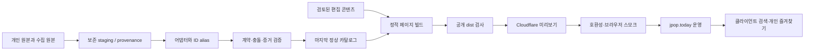

# 목표 아키텍처

상태: 설계 확정, 조직 앱 구현 전. 현재 org 소스는 Node 계약 하네스이며 아래 디렉터리가 이미 존재한다고 가정하지 않는다.

## 기술과 경계

Node.js 24 LTS를 앱 기준으로 삼고, 현재 독립 하네스는 Node >=22를 지원한다. 새 앱은 Astro 정적 생성 + TypeScript를 계획한다. 검색·필터·저장처럼 상호작용이 필요한 부분만 브라우저 JavaScript를 사용하고 서버 렌더가 필요 없는 단순 화면에 React를 일괄 도입하지 않는다. 프레임워크 적용은 별도 구현 작업이며 이 문서 작성으로 설치된 것은 아니다.

Cloudflare Pages Git 연결 또는 명시적 CI artifact 배포 중 실제 프로젝트 접근 후 하나를 선택한다. 운영 브랜치·build output·자동 배포 트리거를 확인하기 전 연결을 바꾸지 않는다. 배포 대상은 공개 dist만이며 원본 JSON/TSV/가사·개발 코드·환경 파일은 제외한다.

데이터 영역은 raw/staging, 검증된 스냅샷, 공개 read model로 분리한다. 수정 작업은 검증·충돌 보고 후 스냅샷을 원자적으로 승격한다. 빌드는 외부 수집 없이 고정 스냅샷으로 재현 가능해야 한다. 수집 실패는 별도 실패 상태로 남기고 현재 사이트를 지우지 않는다.

콘텐츠 영역은 작성자·근거·검토일·정정 이력을 가진 문서로 관리한다. 원문 가사와 외부 이미지는 권한이 검증된 경우에만 publish allowlist를 통과한다. 공개 페이지에는 작업자 내부 상태/심사 준비 보고를 넣지 않는다.

검색 read model은 원제·한국어 표기·별칭·가수·사업자 번호·정규화 검색키를 담는다. 정규화는 검색에만 사용하고 원본 문자열·stable ID를 바꾸지 않는다. 검색 query와 필터는 URL에, 즐겨찾기는 기존 storage key에 유지한다.

## 계획 디렉터리

| 경로 | 역할 |
| --- | --- |
| src/pages, src/components, src/layouts | 정적 페이지와 공통 UI |
| src/content | 자체 가이드·운영 안내, 편집 스키마 |
| src/lib | 검색·번호 상태·URL·저장 어댑터 |
| contracts | 프레임워크 독립 검증·스냅샷 승격 |
| scripts | 원본 변환·수집·build 검증·배포 스모크 |
| data/staging | 공개 제외 원본과 provenance, 이관 오류 보고 |
| data/catalog, data/identity | 정상 스냅샷, stable ID/legacy alias |
| tests | 계약·단위·산출물·브라우저 회귀 |
| dist | 공개 artifact, 직접 편집하지 않음 |

## 배포/관측

소스 SHA, 카탈로그 해시, 콘텐츠 버전, build ID를 artifact와 릴리스 기록에 연결한다. 공개 health 메타는 필요한 버전만 담고 계정·비밀 값을 포함하지 않는다. 링크·404·핵심 흐름·수집 시각·검색 실패를 확인하되 사용자 검색문과 개인 저장 목록을 무단 수집하지 않는다.

자세한 게이트는 [하네스](../engineering/harness.md), 이력·호환성은 [이관](../operations/migration.md), 운영 실행은 [배포](../operations/deployment.md)를 따른다.
