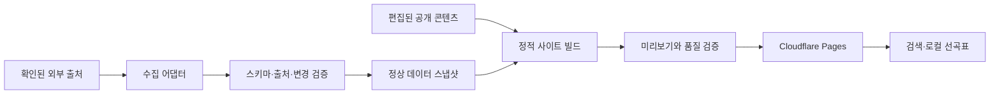

# 시스템 구조

## 방향

정적 HTML + 필요한 부분의 클라이언트 상호작용을 기본으로 한다. 데이터 수집은 사이트 요청과 분리하고 검증된 스냅샷으로 빌드한다. 프레임워크 기본 후보는 Astro + TypeScript이며 원본 조사·측정 후 ADR을 확정한다. 기존 구조가 충분하면 전면 교체보다 모듈 경계부터 개선한다.



## 소스 저장소의 목표 구조

```
src/pages/             정적 라우트와 기존 URL 호환
src/components/        화면 컴포넌트
src/layouts/           제목·canonical·내비게이션·광고 설정
src/lib/search/        정규화·별칭·순위
src/lib/catalog/       데이터 변환·번호 상태
src/lib/storage/       즐겨찾기 버전·ID 이관
src/content/guides/    공개 편집 콘텐츠
data/catalog/          검증된 곡·가수·번호
data/charts/           마지막 정상 차트
contracts/             프레임워크 독립 데이터 검증
scripts/               수집·이관·빌드 산출물 검증
tests/                 의미 있는 동작 회귀 검증
public/                robots·redirects·자산
.github/workflows/     실제 해당 저장소에서 실행하는 CI
```

이는 목표 구조다. 지금 존재하는 앱 구조로 오인하지 않는다. 원본의 실제 구조·라이선스·저장 키를 확인하고 파일을 이관한다. 운영 콘텐츠와 실행 코드의 변경은 한 소스 PR에서 같이 검증한다.

## 경계와 장애 처리

- 곡/가수 ID는 제목 변경과 무관하게 유지한다. 업체별 번호는 출처·곡 버전과 연결한다.
- 데이터 수집 실패는 기존 정상 스냅샷을 지우지 않는다. 빈 응답을 정상 최신 차트로 만들지 않는다.
- 외부 링크나 영상 장애로 곡 번호를 읽을 수 없게 하지 않는다.
- 검색은 작은 정적 색인부터 시작한다. 웹 워커나 검색 서버 도입은 측정 후 결정한다.
- 수집 잡은 사이트 빌드와 다른 권한·실행 단계로 두고, 변경량 이상은 검토 PR로 보낸다.
- 초기에는 외부 이미지를 필수로 두지 않는다. 권리·출처가 확인된 자산만 사용한다.
