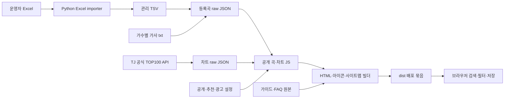

# 현재 구조와 원본 조사

조사일: 2026-10-13, 한국 시간. 이 문서는 저장소에서 확인한 사실과 운영 환경에서 아직 확인하지 못한 사항을 구분한다. 재설계와 이관의 기준 자료이며, 배포 완료 기록이 아니다.

관련 스펙: [SRC-001과 데이터·호환성 요구사항](../product/spec.md). 재설계 결정은 [ADR-002](../adr/002-stable-identity.md), [ADR-003](../adr/003-evidence-and-publication.md)를 기준으로 하고 아래의 관찰과 구분한다.

## 조사 대상과 증거 범위

| 대상 | 확인한 상태 |
| --- | --- |
| 개인 원본 | `kim75503/todayjpop`, 읽기 전용 조사 checkout `/tmp/jpop-original-audit` |
| 원본 기본 브랜치 | Git remote의 `origin/HEAD`는 `origin/dev` |
| `dev` 조사 SHA | `6dbe5a65d1bd729c09393f746f715f4363089a43` |
| `main` 조사 SHA | `c57a7ae1be0c6cff06c847bb7dbc5c572e631edd` |
| 새 소스 | `jpop-today/jpoptoday`; 조사 시작 시 독립 계약 검증 하네스이며 운영 앱과 실제 카탈로그는 아직 이관되지 않음 |
| 새 문서·조직 규칙 | `jpop-today/docs`, `jpop-today/.github` |
| 운영 사이트 | 사용자는 `jpop.today`가 Cloudflare에 정적으로 배포되어 있다고 설명함 |
| 운영 직접 확인 | 초기 CONNECT403 이후 재확인에서 /·공개 JS·robots·sitemap200, 비공개 raw·없는 경로404. 공개 JS3개는 조사 dev와 바이트 일치; 배포 SHA는 미확인 |
| GitHub 제어면 | 초기 API403 이후 PR/API 접근 성공, 새 하네스 Node22 CI success. 배포 목록 API는 integration scope403, Cloudflare 배포 연결은 미확인 |

원본 tracked 파일에서 `AGENTS.md`와 프로젝트 전체 `LICENSE`는 발견하지 못했다. 새 소스의 `AGENTS.md`는 원본·이력·ID·URL·저장 키 조사, `unknown`과 `unlisted` 구분, 검증 결과의 범위 명시를 요구한다.

`main`과 `dev`의 공통 조상은 `9de0d75f65fdf365f5498a3b2cf7c62f2abd094a`이며, 해당 시점 이후 `main`에만 2개, `dev`에만 33개 커밋이 있다. 두 HEAD의 내용 차이는 11개 파일의 차트 스냅샷 및 생성 HTML/JS다. 앱 로직·TSV·가이드 원본·설정·빌드·테스트는 동일하다. 브랜치 이력은 서로 갈라져 있으므로 단순 fast-forward 관계로 설명하면 안 된다.

이후 사용자 CF binding 입력으로 실제 Pages API에서 프로젝트todayjpop, production dev, 배포SHA6dbe5a65d1bd729c09393f746f715f4363089a43, npm run build/dist를 확인했다([기준선](../operations/cloudflare-baseline.md)). 현재 deployment가 조사dev와 같다는 사실을 이제 API 증거로 연결할 수 있다.

## 앱 구조

React나 별도 API 서버를 사용하는 앱이 아니라 Node.js CommonJS 빌더와 브라우저 JavaScript로 구성한 정적 사이트다. 회원가입과 서버 동기화는 없다. 데이터베이스·Workers·Pages Functions·Wrangler 설정은 조사한 tracked 파일에 없다.



| 역할 | 원본 파일 |
| --- | --- |
| 등록곡 입력 | `data/jpop-playlist-karaoke-tj-ky-merged.txt` |
| Excel 변환 | `scripts/import-merged-karaoke-xlsx.py` |
| 등록곡 정규화·ID 생성·가사 참조 해석 | `scripts/build-jpop-playlist-data.js` |
| 차트 수집 | `scripts/fetch-tj-chart.js` |
| 차트와 등록 목록 대조·공개 데이터 생성 | `scripts/build-data.js`, `scripts/data-utils.js`, `scripts/public-data.js` |
| 공통 HTML·SEO·배포 묶음 | `scripts/build-site.js` |
| 가이드 4개·FAQ | `scripts/site-content.js` |
| 등록 번호 현황 | `scripts/coverage.js` |
| 검색·곡 상세·즐겨찾기 | `js/app.js`, `js/catalog.js`, `js/song-ui.js` |
| 필터 상태·최근 필터 | `js/filter.js`, `js/recent-filters.js` |
| 복사·공유·모바일 UI | `js/site-ui.js` |
| 스타일 | `css/style.css` |

`npm run build`는 TSV → raw JSON → 공개 곡/차트 JS → HTML/사이트맵/아이콘/`dist` 순서로 실행된다. 루트 HTML, `js/songs.js`, `js/chart.js`, `js/site-meta.js`, 아이콘과 사이트맵은 생성물이며 빌드가 tracked 파일도 다시 쓴다. `dist/`는 ignored 경로다. 웹 개발 서버는 `dist/`를 127.0.0.1:4173에서 읽으며 원본 변경을 자동 빌드하지 않는다.

`package.json`은 Node `>=18`, README는 Node 24 LTS, 원본 예약 workflow는 Node 24를 지정한다. Python Excel importer는 표준 라이브러리를 사용한다. 과거 Tistory scraper는 `requests`와 `beautifulsoup4`가 필요하며 별도 Python lockfile은 발견되지 않았다. 기본 사이트 빌드에는 재수집이나 개인 컴퓨터의 Excel 원본이 필요하지 않다.

## 실제 카탈로그

아래는 `dev` 조사 SHA의 TSV, raw JSON 및 생성 JS를 로컬에서 읽어 집계한 값이다. 음악 서비스 전체 수록 현황이나 번호 정확도 검증 결과가 아니다.

| 항목 | 실측 |
| --- | ---: |
| 등록 TSV 행·raw 등록곡 | 3,299 |
| 서로 다른 가수 문자열 | 1,110 |
| TJ 번호가 있는 행 | 3,139 |
| KY 번호가 있는 행 | 2,500 |
| 양쪽 번호가 있는 행 | 2,340 |
| TJ 번호만 있는 행 | 799 |
| KY 번호만 있는 행 | 160 |
| 한글 제목이 있는 행 | 1,821 |
| 한글 가수명이 있는 행 | 2,081 |
| 행별 `sourceTitle`·`sourceUrl`가 있는 행 | 각각 0 |
| 차트 곡 | 100 |
| 차트 ID가 등록 목록과 연결된 곡 | 86 |
| `dev` 검색 합집합 | 3,313 |

TSV 컬럼은 `title`, `titleKo`, `artist`, `artistKo`, `TJ`, `KY`, `tags`, `source_title`, `source_url`, `lyricsText`다. 뒤 세 컬럼은 선택 필드이며 마지막 필드는 대부분 가사 파일 참조다. raw JSON 메타데이터는 `merged TJ/KY karaoke workbook`, `TJ first, then KY`라고 기록한다. 이 문구는 행별 번호가 공식 검증되었다는 증거가 아니다.

원본 README와 `/about` 생성 원본은 초기 자료에 J-POP PLAYLIST Tistory가 포함되었다고 설명한다. `scripts/scrape-jpop-playlist-tj-ky-only.py`에는 `/98`, `/417`, `/988`, `/96`, `/288`, `/720`, `/664`의 인덱스·상세 글을 수집하는 코드가 남아 있다. 그러나 현재 관리 TSV의 모든 행은 개별 출처 제목·URL이 비어 있다. 개별 곡의 원래 수집 페이지, 확인 날짜, 번호 검증 여부, 이용 허락을 이 코드만으로 복원할 수 없다. scraper 출력 파일과 실제 build 입력 TSV도 서로 다르다.

등록 데이터에는 `checkedAt`, 확인자, 업체별 검증 상태, 곡 버전 식별자가 없다. 빈 번호는 아직 확보하지 못한 정보일 수 있으므로 `unlisted`로 변환할 근거가 없다. Git 커밋 날짜나 새 환경의 이관 날짜를 번호 확인 날짜로 사용하면 안 된다. `normalizeSong`은 raw의 `sourceTitle`·`sourceUrl`를 공개 곡 객체에 보존하지 않는다.

### 데이터 품질 관찰

등록곡 ID 중복과 TJ 번호 중복은 없었다. KY 번호 7개는 2~3행에 반복된다. 번호만으로 자동 병합하면 가수·언어·커버·버전이 다른 곡을 연결할 수 있다.

| KY 번호 | 등록 행의 제목·가수 예시 | 처리 |
| --- | --- | --- |
| `43011` | ワールドイズマイン / supercell, 보컬로이드 | 공식 곡·버전 대조 필요 |
| `43060` | Don't say “lazy” / V급밴드, 사쿠라고 경음부, 桜高軽音部 | 3행 대조 필요 |
| `80603` | 최종화, 最終花 / 아이리 칸나 | 제목 언어·버전 대조 필요 |
| `44671` | 내 꿈은 파티시엘 / 아이유, 夢にエール！パティシエール♪ / 五條真由美 | 언어·가수 대조 필요 |
| `40554` | Butter-Fly / 전영호, 和田光司 | 언어·가수 대조 필요 |
| `57803` | フォニイ / ツミキ, チューリングラブ feat.Sou / ナナヲアカリ | 서로 다른 제목; 번호 오류 여부 우선 확인 |
| `41637` | 눈의 꽃, 雪の華 / 中島美嘉 | 제목·버전 대조 필요 |

Excel importer는 `csv.writer`로 TSV 인용 처리를 하지만 등록곡 builder는 줄을 단순 `split("\t")`한다. 그래서 `under "Mebius"`, `Running In The "90's"`, `Don't say "lazy"` 3곡에는 외부 따옴표와 이중 따옴표가 실제 raw 제목에 남아 있다. 이를 수정하면 아래 ID 생성 방식 때문에 ID도 바뀔 수 있다. 별도 parser 개선과 alias 검증이 필요하며, 이번 조사는 원본을 수정하지 않았다.

## 차트 출처와 신선도

수집 대상은 `https://www.tjmedia.com/legacy/api/topAndHot100`에 대한 form POST이며 공개 출처 링크는 `https://www.tjmedia.com/chart/top100`다. `chartType=TOP`, `strType=3`와 날짜 파라미터 조합을 순서대로 시도한다. 90곡 미만, 제목·가수·숫자 번호 누락, TJ 번호 중복이면 기존 snapshot을 덮어쓰지 않는다.

| 브랜치 | raw의 수집 시각, 한국 시간 | 요청 집계 기간 |
| --- | --- | --- |
| `main` 조사 SHA | 2026-09-10 10:17:55 | 2026-08-27 ~ 2026-09-10 |
| `dev` 조사 SHA | 2026-10-12 19:39:12 | 2026-09-28 ~ 2026-10-12 |

위 시각은 저장된 `fetchedAt`의 해석이며 이번 조사에서 TJ에 새 요청하여 확인한 결과가 아니다. `periodVerified: true`는 수집 코드가 날짜 파라미터를 넣은 요청을 사용했다는 뜻이다. 응답이 해당 기간을 실제 반영했는지 별도로 대조한 증거는 아니다. 화면에는 요청 기간과 가져온 시각을 나누어 표시하며 4일 이상 오래되면 지연 안내를 표시한다.

등록곡과 차트는 ID, 정규화한 제목·가수, 번호 후보와 제목·가수 대조로 연결된다. 차트의 KY 번호는 등록 목록에서 보완하며 KY 순위가 아니다. 차트 전용 ID는 제목·가수 slug에 의존한다. 차트에서 빠진 곡의 영구 보존 저장소는 따로 없다.

## ID·URL·브라우저 저장 호환성

등록곡 ID는 다음 방식이다.

```text
jpop-playlist-<slug(artist-title)>-<SHA1(title|artist|TJ|KY)의 앞 10자리>
```

이는 같은 입력에서 재현되지만 변경에 독립적인 ID는 아니다. 제목·가수·TJ·KY 정정은 기존 공유 주소와 즐겨찾기의 연결을 바꿀 수 있다. 새 구조에서는 기존 ID를 그대로 초기 ID로 가져오고, 영구 내부 ID 또는 정정 alias를 별도로 유지해야 한다.

| 계약 | 현재 코드에서 확인한 동작 |
| --- | --- |
| 곡 주소 | `/song?id=<URL encoded id>` |
| 검색 주소 | `/filter?q=<검색어>`; 홈도 `q`를 읽음 |
| 필터 주소 | 반복 가능한 `number`, `tag`; `anime=all`, `artist=all`, `page` |
| 번호 필터 | `has-tj`, `has-ky`, `only-tj`, `only-ky` |
| 예전 즐겨찾기 주소 | `/#favorites-view`를 `/favorites`로 이동 |
| 즐겨찾기 키 | `jpop_today_favorites` |
| 즐겨찾기 형식 | 문자열 ID 배열과 예전 `{ id }` 배열을 모두 읽음 |
| 미해결 즐겨찾기 ID | 저장된 ID를 유지하고 렌더링에서만 현재 카탈로그와 연결되지 않은 항목을 제외 |
| 최근 필터 키 | `jpop_today_recent_filters` |
| 최근 필터 형식 | 최대 5개 `{ id, type, value, savedAt }`; 이전 전체 조건 snapshot도 읽음 |
| 저장 실패 | 즐겨찾기는 페이지 메모리로 유지하며 영구 저장 실패 안내 |

`main`과 `dev` 각각의 검색 합집합은 3,313 ID지만 구성은 다르다. 두 SHA에서 확인한 합집합은 **3,317 ID**이며 등록곡 3,299개와 차트 전용 ID 18개를 포함한다. `dev`만 이관하면 `main` 차트 전용 ID 4개를 놓친다. 이것은 최소 보존 목록이며 과거 모든 운영 버전의 ID가 수집되었다는 뜻은 아니다.

브라우저 저장은 origin 단위다. 같은 HTTPS `jpop.today`를 유지하면 새 GitHub 저장소나 Cloudflare 프로젝트로 이동해도 키를 읽을 수 있다. 별도의 preview 도메인이나 `www` origin에서 운영 브라우저 저장 데이터가 보이지 않는 것은 예상 동작이다.

## 공개 콘텐츠와 권리 상태

| 자료 | 저장소에서 확인한 상태 | 판단 범위 |
| --- | --- | --- |
| 가사 txt | 3,299파일 중 비어 있지 않은 파일 7개 | 파일 존재가 이용 허락의 증거는 아님 |
| 공개 가사 설정 | `lyrics.publishAll: true`, `approvedSongIds: []` | 7곡 모두 공개 JS에서 `/lyrics/<24자리 내용 해시>.txt`로 참조됨 |
| 가사 공개 안내 | `/about` 생성 원본은 허락이 확인된 자료만 제공한다고 설명 | 실제 설정과 개별 권리 증거를 대조해야 함 |
| 등록곡 이미지 | 전부 로컬 placeholder SVG | 기존 자체 SVG 보존 가능 여부를 원본 소유·이력과 함께 기록 |
| 차트 이미지 | 100곡 모두 `www.tjmedia.com/SONG_ALBUMIMG/...` 외부 URL | URL이 있다고 재사용 허락을 확인한 것은 아님 |
| 아이콘 | Lucide sprite 및 `assets/lucide-LICENSE.txt` | ISC 및 일부 Feather 기반 MIT 고지 있음; 함께 이관 |
| 프로젝트 코드 전체 | 루트 LICENSE 미발견 | 사용자 자신의 코드 이관 위임과 별개로 외부 코드·자료의 고지 점검 필요 |
| 가이드 | 검색·번호 비교·차트·저장에 관한 4개 정적 가이드 | 현재 서비스 동작에 연결되어 있으며 난이도·음역 데이터는 없음 |

비어 있지 않은 가사 파일은 優里/ピーターパン, tuki./晩餐歌, Official髭男dism/Pretender·115万キロのフィルム, Mrs. GREEN APPLE/ライラック·ダーリン·ア・プリオリ다. 조사에서는 본문을 복제하지 않았다. 개별 사용 허락, 허락 주체, 범위, 만료일, 증빙 링크는 확인하지 못했다.

원본 bundle allowlist는 `data/`, 개발 도구, 원본 가사 경로를 `dist`에서 제외한다. 허용된 공개 가사만 별도 hash 경로에 생성한다. `dist` 제외는 GitHub 저장소의 공개 범위나 과거 배포의 비공개 여부를 보장하지 않는다.

## 페이지·SEO·광고

생성 페이지는 홈, 필터, 차트, 즐겨찾기, 곡 상세, 가이드 목록과 4개 가이드, 현황 비교, FAQ, 소개, 문의, 개인정보, 404의 16개다. 차트·가이드·현황·정책 본문은 HTML에 들어간다. 검색·즐겨찾기·곡 상세는 JavaScript를 사용한다.

`/filter`, `/favorites`, `/song`, `/404`는 `noindex, follow`이며 사이트맵에서 제외된다. 개별 곡의 본문·메타데이터를 서버에서 생성하는 구조는 없다. 곡 상세의 canonical은 브라우저에서 곡을 찾은 뒤 변경된다. 재설계 시 검색 유입용 곡 페이지를 만들려면 고유 내용과 정적 결과가 충분한 페이지부터 index 정책을 따로 정해야 한다.

`data/site-settings.json`은 `advertising.enabled: true`, 기존 공개 publisher ID `ca-pub-5861067712842534`를 기록한다. 모든 생성 HTML에는 같은 AdSense script가 들어가며 소유권 meta와 `ads.txt`가 있다. 이는 광고 코드 설정의 증거이며 승인·광고 게재·수익의 증거가 아니다. 생성 안내의 편집일은 `2026-09-10`이다.

문의는 기존 Google Forms 외부 링크와 공개 운영 이메일로 연결된다. 코드에는 로그인·자체 제보 수신 API·제보 관리 화면이 없다. 운영 계정의 실제 접근 권한, 문의 전달 상태, Google Search Console와 AdSense 계정 상태, 지역별 동의 설정은 미확인이다.

## 배포·CI·기존 하네스

원본 README의 목표 설정은 Cloudflare Pages `npm run build`, output `dist`, root 저장소 루트, `NODE_VERSION=24`다. `_redirects`는 HTTP와 `www`를 HTTPS apex로 301 처리한다. `_headers`는 MIME sniffing 방지, referrer/permissions/frame 정책과 캐시 정책을 정의한다. 로컬 서버에는 `.html` 주소를 확장자 없는 주소로 query 보존 301 처리하는 코드와 실제 404 처리 코드가 있다. 로컬 서버의 결과만으로 Cloudflare의 실제 동작을 확인했다고 말할 수 없다.

확인한 원본 workflow는 `.github/workflows/update-data.yml` 하나다. 한국 시간 매일 12:10 예약과 수동 실행으로 설치 → TJ 수집 → build → JS 문법 검사 → Node tests → 생성물 commit/push를 실행한다. `contents: write`이고 bot이 기본 checkout 브랜치에 직접 push한다. regular PR build/test workflow나 Cloudflare 배포 workflow는 발견하지 못했다. Pages Git 연동 여부와 실제 Actions 성공 여부는 별도 확인이 필요하다.

원본의 Node 테스트는 검색·병합·추천·번호 현황·가사 공개 경계·escaping·ID/차트 필드·배포 allowlist·정적 콘텐츠·광고 태그를 검사한다. Playwright는 desktop Chromium, mobile Chromium, mobile WebKit에서 검색·저장·복사·필터 URL·반응형·접근성·저장 실패·가사 재시도·내부 링크·404를 검사한다. 원본 UI 회귀 테스트는 기본적으로 AdSense 외부 스크립트를 대체하며 `JPOP_LIVE_ADS=1`을 별도 진단에 사용한다.

읽기 전용 원본 checkout에서는 Git 비교, 파일 열람, 집계만 실행했다. 별도 복사본 `/tmp/jpop-build-audit`에서 같은 `dev` 기준 앱의 재현 검증을 실행하여 원본 checkout은 보존했다. 수집·원본 commit·원본 push는 실행하지 않았다.

| 별도 복사본 검증 | 문서 작성 시점 결과 |
| --- | --- |
| `npm ci` | 완료 |
| `npm run build` | 성공; 정적 페이지 16개, sitemap URL 12개 |
| `npm run check:js` | 성공; JS 파일 25개 |
| `npm test` | 12개 모두 통과 |
| Playwright desktop/mobile Chromium | 시스템 Chromium 외부 설정으로 36개 등록, 33개 통과·3개 의도적 건너뜀·실패 0 (60.7초) |
| Playwright WebKit | 미실행 |
| 실제 운영 대표 사용자 흐름 | desktop/mobile Chromium2개 통과, 실제 광고 script는 테스트 stub |
| 외부 광고·실제 심사 상태 | 미확인 |

위 재현 결과는 원본 앱의 로컬 검증이며 새 소스 이관·운영 배포 성공을 뜻하지 않는다. 새 소스의 합성 계약 테스트 통과 역시 실제 카탈로그·사이트·운영 배포 통과와 구분한다. 현재 실행 JSON 결과는 /tmp/jpop-browser-results.json에 있으며 검증 범위는 desktop 1440×1000, mobile 390×844 및 기존 viewport sweep이다. Browser plugin not available로 기존 Playwright를 사용했다. 운영 사이트·실제 광고·실기기 검증은 미실행이다.

## 재설계가 해결할 우선 과제

1. 기존 3,317 ID 최소 목록과 실제 운영 SHA의 ID·URL·저장 호환성을 먼저 확보한다.
2. 카탈로그 imported 정보와 공식 확인된 사실을 구분하고 누락된 출처·확인일을 임의로 채우지 않는다.
3. KY 충돌과 TSV 인용 처리 오류를 정정할 수 있는 증거·alias·리뷰 절차를 만든다.
4. 확인된 사용 권한에 맞춰 가사·외부 이미지 공개 범위를 제어한다. 안내문과 설정의 일치도 검사한다.
5. 콘텐츠 원본과 generated 산출물을 분리하고 CI에서 재현 가능한 build와 공개 경계를 검사한다.
6. 검색 페이지에 현재 약 2.1 MB의 비압축 등록곡 JS와 차트 JS를 보내는 구조를 측정하고 필요한 데이터만 전달하도록 개선한다.
7. 데이터 갱신을 review 가능한 변경으로 만들고 실패 시 마지막 정상 snapshot·배포를 보존한다.
8. 실제 Cloudflare 연결·운영 SHA·preview·rollback 증거를 확보한 뒤 기존 도메인으로 전환한다.
9. 원제·번호 대조와 근거 있는 가이드의 가치를 높이고 실제 Search Console·AdSense 결과를 운영 기록에 남긴다.

## 고정 증거 링크

- [원본 dev README](https://github.com/kim75503/todayjpop/blob/6dbe5a65d1bd729c09393f746f715f4363089a43/README.md)
- [원본 관리 TSV](https://github.com/kim75503/todayjpop/blob/6dbe5a65d1bd729c09393f746f715f4363089a43/data/jpop-playlist-karaoke-tj-ky-merged.txt)
- [등록곡 raw JSON](https://github.com/kim75503/todayjpop/blob/6dbe5a65d1bd729c09393f746f715f4363089a43/data/jpop-playlist.raw.json)
- [ID·TSV 처리](https://github.com/kim75503/todayjpop/blob/6dbe5a65d1bd729c09393f746f715f4363089a43/scripts/build-jpop-playlist-data.js)
- [사이트 설정](https://github.com/kim75503/todayjpop/blob/6dbe5a65d1bd729c09393f746f715f4363089a43/data/site-settings.json)
- [공개 가사 처리](https://github.com/kim75503/todayjpop/blob/6dbe5a65d1bd729c09393f746f715f4363089a43/scripts/public-data.js)
- [TJ 수집기](https://github.com/kim75503/todayjpop/blob/6dbe5a65d1bd729c09393f746f715f4363089a43/scripts/fetch-tj-chart.js)
- [dev 차트 snapshot](https://github.com/kim75503/todayjpop/blob/6dbe5a65d1bd729c09393f746f715f4363089a43/data/chart.raw.json)
- [main 차트 snapshot](https://github.com/kim75503/todayjpop/blob/c57a7ae1be0c6cff06c847bb7dbc5c572e631edd/data/chart.raw.json)
- [HTML·배포 allowlist](https://github.com/kim75503/todayjpop/blob/6dbe5a65d1bd729c09393f746f715f4363089a43/scripts/build-site.js)
- [앱·즐겨찾기](https://github.com/kim75503/todayjpop/blob/6dbe5a65d1bd729c09393f746f715f4363089a43/js/app.js)
- [필터 URL](https://github.com/kim75503/todayjpop/blob/6dbe5a65d1bd729c09393f746f715f4363089a43/js/filter.js)
- [원본 갱신 workflow](https://github.com/kim75503/todayjpop/blob/6dbe5a65d1bd729c09393f746f715f4363089a43/.github/workflows/update-data.yml)
- [이관 실행 절차](../operations/migration.md)

## 조사 후 구현한 보존 기준

새 소스의 data/legacy-identity-baseline.json에 두 고정 SHA의 4개 파일 SHA-256·행 참조와 3,317 ID를 저장했다. 공개 카탈로그 이관이 아닌 identity 감사 자료다. 등록 목록 3,299·차트 전용18, 공유 번호 후보11그룹(TJ4/KY7)은 미해결로 유지한다. 가사·이미지·행별 출처/확인일은 복제하지 않았다. 실제 CLI 재생성 --check와 기준선 메타데이터/refs 무결성 테스트를 포함해55테스트가 통과했고 Node22 CI도 성공했다([하네스](../engineering/harness.md)).
