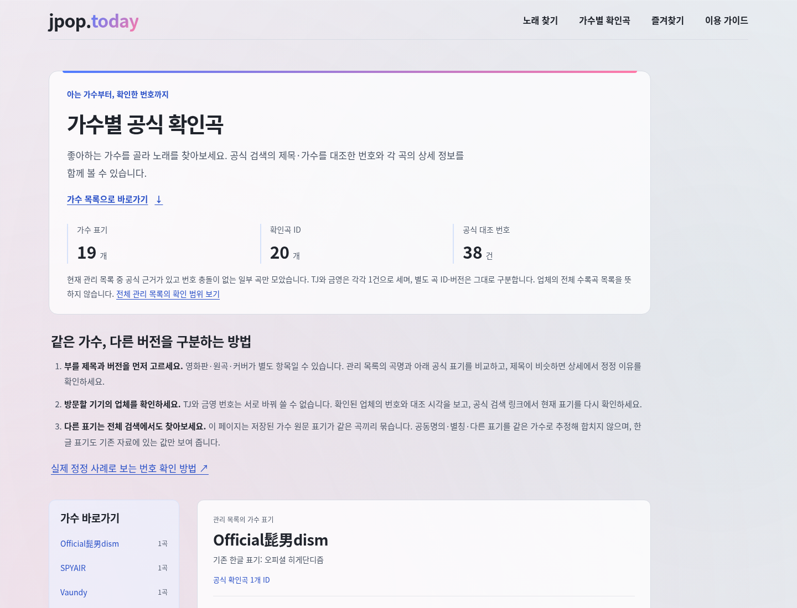
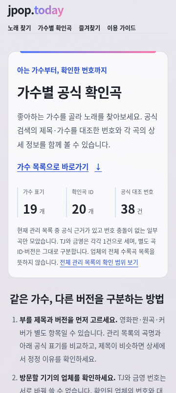
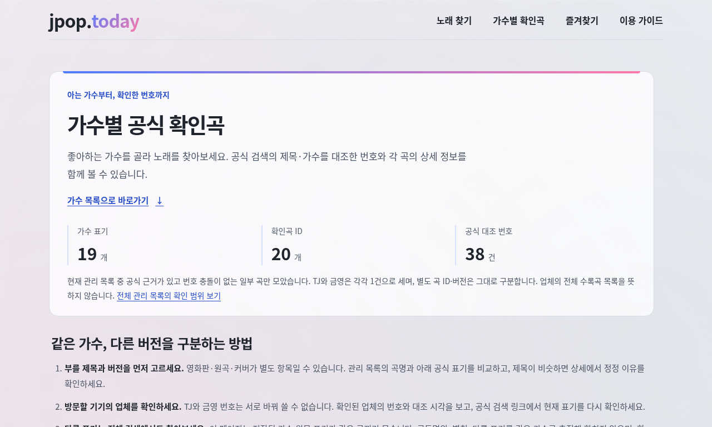
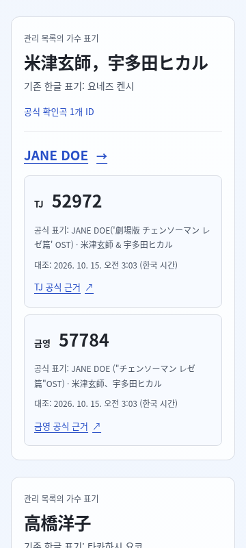

# 가수별 공식 확인곡 탐색

상태: 페이지 구현·로컬 브라우저 검증 인계 · 원격 CI/배포 검증 대기 · 2026-10-15 KST. [Issue #6](https://github.com/jpop-today/jpoptoday/issues/6), run `resume-20261015-0300` · CONTENT-001/SONG-001/DATA-001/SEO-001/DESIGN-001 · [스펙](../product/spec.md) · [ADR-006](../adr/006-reviewed-corrections-and-production.md).

## 계약과 범위

- 담당: `/root/resume_0300_ui`. 소스 base `d17b9c8ad555cd97214c67b864a9c263be402186`, docs base `78c91f42a01b10639c01463e84a7c2a427d503d1`, branch `codex/6-reviewed-discovery-20261015`.
- 단독 파일: 소스 `src/pages/artists.astro`, 이 문서. 공용 계약·카탈로그·번호 ledger·홈/메뉴·스펙·배포·Git·package/lockfile은 관리자가 통합한다.
- 수용 기준: 현재 관리 목록 중 안전한 공식 근거가 있는 곡을 실제 관리 가수 표기별로 묶고, JavaScript 없이 가수 anchor·기존 곡 URL·근거 링크를 제공한다. 번호 문자열과 근거의 실제 대조 시각을 보존한다. 관측/unknown/충돌 번호를 공식 확인값으로 노출하지 않는다. 360px·키보드·브랜드 색과 기존 저장 호환을 실제 하네스로 확인한다.

## 제품 행동

`/artists/`는 하나의 정적 탐색 페이지다. `buildConfirmedArtistGroups(songs)`의 현재 playlist·충돌 없는 공식 번호 집합을 사용한다. 별도 가수 약력 페이지나 가사·이미지는 만들지 않는다. 가수 원문 문자열이 정확히 같은 항목끼리 모으고, 공동명의·별칭·다른 표기를 같은 인물로 추정해 합치지 않는다. 기존 한국어 표기만 부연한다.

첫 화면은 확인 범위의 가수 표기 수·곡 ID 수·업체 번호 수를 구분한다. 제목·버전 선택 → 방문 기기의 업체 확인 → 다른 표기는 전체 검색의 세 가지 선곡 방법과 실제 번호 정정 사례 가이드로 연결한다. 전체 업체 수록곡 목록이나 전체 검증 완료라고 설명하지 않는다.

가수 바로가기의 native anchor는 공용 모듈이 정한 `artist-<exact-label SHA256의 앞16자리>`를 사용한다. 각 가수 `h2` 아래 곡 `h3`가 기존 `songHref(song.id)`로 이어진다. `confirmedNumbers(song)`이 반환한 번호만 업체별 카드에 표시한다. 공식 제목·가수, ledger의 `checkedAt`을 한국 시간으로 렌더링한 `<time datetime>`, 공식 검색 링크를 함께 제공한다. 안전하지 않은 다른 업체는 번호 없이 상태를 알리고 상세로 연결한다. ‘확인 필요’는 미수록을 뜻하지 않는다고 페이지에서 명시한다.

## 디자인과 접근성

기존 전역 CSS를 수정하지 않고 파랑 `#4f7cff` → 분홍 `#ff7aa8` 선형 그라데이션과 pink/mint/blue 배경 palette를 유지한다. 데스크톱은 가수 바로가기와 곡 카드의 두 열, 900px 이하에서는 바로가기를 상단 목록으로 배치하고 600px 이하에서는 번호 카드를 한 열로 보인다. 높이 1050px 이하의 데스크톱은 가수 목록을 고정하지 않아 긴 바로가기의 아래 항목도 일반 문서 스크롤로 접근한다. 원문 가수·곡명·근거는 줄바꿈할 수 있다. 첫 화면의 ‘가수 목록으로 바로가기’는 안내를 이미 읽은 사용자가 native anchor로 곧바로 목록에 접근하게 한다.

`h1` → 가수 `h2` → 곡 `h3`, 의미 있는 `nav`·`ul`·업체 `section`, 44px 이상의 anchor와 기존 focus-visible 스타일을 사용한다. 근거의 새 탭 링크는 `noopener noreferrer`와 보조기술용 새 탭 안내를 포함한다. 별도 페이지 JavaScript는 추가하지 않는다.

## 실제 확인과 남은 검증

2026-10-15 KST 환경 도구에서 revision141/current/running/connected, network enforced를 읽었다. cloud runtime과 frontend-testing-debugging skill을 적용했다. Browser plugin이 현재 도구/skill 목록에 없어 `Browser plugin not available`로 분류한다. 관리자가 조정하는 시스템 Chromium/Playwright fallback으로 검증한다.

관리자가 통합한 미커밋 preview artifact를 루트 소유 `http://127.0.0.1:4321`에서 실제 검증했다. base SHA는 위 계약과 같고 dirty 작업본이므로 clean SHA의 CI·Cloudflare preview·운영 배포 근거와 구분한다. 관리자는 단위 286개 통과·type 0오류/0경고·preview 산출물 3,335 HTML/3,345파일/0 index 결과를 인계했다. UI 담당이 이 문서에서 직접 확인한 것은 아래 독립 렌더와 상호작용이다.

검증 흐름: `/artists/` → 첫 화면의 가수 목록 바로가기 → 공동명의 `米津玄師，宇多田ヒカル`의 정확한 별도 그룹 → JANE DOE의 기존 곡 URL → 공식 번호·근거·실제 대조 시각 확인. JS-off와 키보드 Enter에서도 정적 본문·링크가 작동했다. JANE DOE의 TJ52972/금영57784와 ledger의 `2026-10-15T03:03:47.678068+09:00`를 읽었고, 개인 `米津玄師` 그룹과 공동명의 그룹을 합치지 않았다.

### 독립 렌더 확인

관측 시각 `2026-10-14T18:15:11.586Z` = 2026-10-15 03:15:11 KST. 실행: `node /tmp/jpop-0300-artists-qa.mjs http://127.0.0.1:4321` (local network grant, Playwright/system `/usr/bin/chromium`). 세 viewport 모두 최종 PASS다.

| 확인 | 실제 결과 |
| --- | --- |
| 페이지 URL/title/h1·빈 페이지 | `/artists/`, `가수별 공식 확인곡 &#124; jpop.today`, 의미 있는 정적 본문·19 가수 표기/20곡 ID/38 공식 번호 |
| 오류 overlay·콘솔 | 3회 모두 overlay false, pageerror/console error/warning 배열 비어 있음 |
| 첫 viewport/줄바꿈 | 1440×1100, 360×800, 1280×768 PNG 직접 읽음. 읽을 수 있는 범위·제목·번호·근거, 겹침/잘림 없음 |
| 360px·짧은 데스크톱 | 모든 viewport에서 문서 가로폭=viewport, 상세도 넘침 없음. 360px JS-off·768px 높이 가수 index는 static |
| 키보드·실제 이동 | native 첫 jump와 공동명의 그룹 hash 일치, 상세 URL이 기존 encoded songHref와 일치, h1 JANE DOE·같은 공식 근거 1개 |
| 광고 요청·브랜드 | 광고 호스트 요청 없음. DOM computed brand gradient가 rgb(79,124,255)→rgb(255,122,168), 기존 pink/mint/blue body 배경 유지 |

### 실패를 보존한 동기화 보완

첫 temporary QA script는 Enter 직후 navigation 완료 전 `page.url()`을 읽었다. 상세 h1은 JANE DOE로 바뀐 뒤였지만 먼저 읽힌 URL은 `/artists/`여서 3회 false로 기록됐다. 원본 receipt `/tmp/jpop-0300-artists-ui-qa-navigation-race.json`을 보존했다. 상세 URL 대기를 추가한 두 번째 실행은 모바일만 통과하고 JS-on의 첫 fragment를 완료 전에 읽은 결과가 남아 `/tmp/jpop-0300-ui-qa-fragment-race.json`으로 보존했다. 첫 jump·그룹 hash·상세 URL 모두 `waitForURL`로 관측 완료를 기다린 뒤 별도 `/tmp/jpop-0300-ui-qa-verified.json`에서 3회 PASS했다. UI 페이지 코드는 이 재검증 과정에서 바꾸지 않았다.

품질 담당의 root E2E 역시 첫 정상 서버 실행에서 21PASS/1FAIL(Enter 후 즉시 URL assertion)로 같은 문제를 드러냈다. 담당이 URL/fragment 대기를 보완했고 관리자의 전체 재실행 로그 `/tmp/jpop-0300-preview-e2e-passed.txt`를 UI 담당이 직접 읽어 **22/22 PASS, 34.3초**를 확인했다. 새 가수 탐색 3개·기존 19개가 함께 통과했고, 기존 객체 즐겨찾기/미해결 ID/legacy URL 보존도 실제 검사에 포함됐다. 원래 서버 권한 오류/미연결 실행과 이 race, 최종 실행은 별도 증거이며 첫 실패를 PASS로 바꾸지 않는다.

### 인계와 한계

원본 local safe receipt·PNG는 `/tmp/jpop-0300-ui-qa-verified.json`과 `/tmp/jpop-0300-ui-verified-*.png`다. 관리자가 복사한 공개 기록의 실제 파일 존재를 확인했다: [최종 3viewport 검증](../operations/runs/resume-20261015-0300-ui-qa-verified.json), [첫 상세 URL race](../operations/runs/resume-20261015-0300-ui-qa-navigation-race.json), [첫 fragment race](../operations/runs/resume-20261015-0300-ui-qa-fragment-race.json). 원본 실패를 수정하거나 덮어쓰지 않는다. 아래 선별 PNG는 UI 담당이 직접 읽었고 root도 desktop/mobile/mobile joint anchor를 독립적으로 읽었다.

현재 UI 담당 검증은 시스템 Chromium과 위 3개 viewport·동결 작업본 범위다. 다른 브라우저/스크린리더·원격 CF 응답·Google 계정/심사 결과는 이 검증으로 확인하지 않았다. 전체 22E2E는 위 로컬 결과로 확인했으며, clean SHA CI/CF preview/실제 운영·복구는 관리자의 별도 릴리스/실행 기록을 따른다. 기존 즐겨찾기 회귀와 단위 경계는 [품질 하네스 기록](confirmed-discovery-harness-20261015.md)에 연결한다. 현재 운영은 root가 재확인한 v0.3.1/source67c7ee0 상태로 이번 페이지가 운영 배포됐다고 주장하지 않는다.


## 스크린샷 증거

1440×1100 첫 화면:



360×800·JavaScript 없이 첫 화면:



1280×768·짧은 데스크톱 첫 화면:



360×800·공동명의 그룹을 선택한 화면:



## 읽기 전용 동료 평가

최종 담당 산출물과 실제 로컬 검증을 읽고 한 평가다. 산출물을 수정하지 않았으며 아래 원문 점수/근거를 root에게 그대로 인계한다. 평가 시각은 최종 독립 metadata 검증 `2026-10-14T18:21:54.638598Z` 이후이며, 원격 CI/운영 결과는 포함하지 않는다.

```json
[
  {
    "reviewer": "/root/resume_0300_ui",
    "candidate": "/root/resume_0300_evidence",
    "scores": {
      "correctness": 5,
      "evidence": 5,
      "value": 5,
      "maintainability": 4
    },
    "criterionReasons": {
      "correctness": "동결 차트 상위10곡의20 ID/provider 쌍만 confirm으로 추가했다. base43개 객체·순서가 그대로이고 staging/chart/global CSS 바이트도 동일하다. 공식 OST 부제·기호 차이와 공동명의 판단을 원문 관리 표기와 행별 비교했고 unknown·기존 suppress13개·stable ID를 보존했다.",
      "evidence": "docs·ledger·requests20행을 실제 읽고 별도 streaming HTMLParser로 저장 원문을 strict UTF-8 파싱했다.20개 모두 raw SHA/bytes·HTTP200·최종 URL·번호·공식 제목/가수·checkedAt가 ledger와 정확히 일치했다. 독립 최종 receipt PASS, root286unit/type 및 preview22PASS 로그를 읽었다. 최초 본인 regex 검토기는 중첩 markup으로0행을 읽어 실패했고 원본 실패를 보존한 뒤 streaming parser로 검증했다.",
      "value": "현재 관리 목록에서 인기곡10개·양사20번호의 공식 근거가 늘어 가수 탐색/곡 상세/번호범위에 실제 적용됐다. 기존 관측을 전체 검증이라고 포장하거나 새 버전/미수록을 추정하지 않았다.",
      "maintainability": "기존 ADR-006 구조에 append해 schema/정정 이유/실제확인일을 추적한다. 다만 수집·원문 재파싱 스크립트와 원문은 임시 /tmp 경로에만 있어 다음 환경에서 동일 과거응답을 재현하려면 별도 안전한 증거 보존/재조사가 필요하므로4점이다. 원문을 공개 Git에 넣자는 의미는 아니다."
    },
    "reason": "실제20개 원문의 metadata와 hash를 독립 재파싱·대조하고 base43개/원본 바이트를 보존했음을 확인해 담당 데이터 산출물을 수용한다. 권리·가사 출력 사고·Google심사·배포 미완료를 명확히 분리한다.",
    "evidence": [
      "data/reviewed/provider-corrections.json",
      "data/provider-review-20261015.md",
      "/tmp/jpop-provider-review-20261015/requests.json",
      "/tmp/jpop-provider-review-20261015/validation.json",
      "/tmp/jpop-0300-ui-peer-evidence-verified.json",
      "/tmp/jpop-0300-ui-peer-evidence-regex-failed.json",
      "/tmp/jpop-0300-unit.txt",
      "/tmp/jpop-0300-preview-e2e-passed.txt"
    ],
    "acceptance": "Final assigned data artifact accepted. 실제20개 재파싱 PASS·로컬 preview22PASS를 읽었으며 clean SHA CI/CF preview/production/실제복구/Release는 root의 별도 다음 게이트다. 새운영 배포·AdSense 승인으로 기록하지 않는다."
  },
  {
    "reviewer": "/root/resume_0300_ui",
    "candidate": "/root/resume_0300_quality",
    "scores": {
      "correctness": 5,
      "evidence": 5,
      "value": 5,
      "maintainability": 5
    },
    "criterionReasons": {
      "correctness": "11개 단위 소스를 실제 읽었다. 비확인상태·모호한 conflict·숫자형/선행0·잘못된 공식 URL·근거 누락·archived/chart-only·중복 ID·별칭/공동명의·stable anchor·deep-frozen Unicode/% URL을 검사한다. 실자료 기대집합은 ledger/raw의 번호 중복을 독립 재계산하여 helper출력을 정답으로 쓰지 않는다.",
      "evidence": "실제root 로그에서 개별11개 포함 전체286PASS/type0 및 새3개E2E 포함22PASS34.3s를 읽었다. 초기에 잘못된 negativefixture10PASS/1FAIL과 navigation race21PASS/1FAIL을 문서에 보존했다. 기대 경로를 유지한 URL/fragment 대기 수정과 재실행결과를 확인했고 UI독립 JSoff/3viewport PASS도 읽기/실행으로 교차 확인했다.",
      "value": "관측 번호를 공식 확인값으로 잘못 표시하는 위험과 별칭 합치기·버전/ID/URL/기존 객체즐겨찾기·미해결 ID 손실을 방지한다. 실제prod/preview meta와 sitemap도 target기준으로 검사하여 운영 배포 게이트에 직접 필요한 회귀다.",
      "maintainability": "새 dependency·서버·배포 조작 없이 단독11unit/3e2e로 독립 경계를 유지한다. 실제 served catalog와 frozen ledger에서 기대집합을 산출해 번호 검토가 늘어도 가짜 고정 count수정으로 테스트를 맞추지 않는다. 명확한 locator 계약과 완료를 기다리는 assertion, fixture불변성·초기화1회 저장검사로 진단이 가능하다."
    },
    "reason": "실자료 독립 기대집합·부정 fixture·JSoff 키보드·기존저장 보존을 검증한 하네스를 수용한다. 실제 실패와 완료 후 통과를 구분했고 최초 즉시 URL읽기 문제를 관측 대기로 수정했다.",
    "evidence": [
      "tests/confirmed-discovery.test.mjs",
      "e2e/artists.spec.ts",
      "engineering/confirmed-discovery-harness-20261015.md",
      "/tmp/jpop-0300-unit.txt",
      "/tmp/jpop-0300-check.txt",
      "/tmp/jpop-0300-preview-e2e-final.txt",
      "/tmp/jpop-0300-preview-e2e-passed.txt",
      "operations/runs/resume-20261015-0300-ui-qa-verified.json"
    ],
    "acceptance": "Final assigned harness artifact accepted. 로컬 preview22PASS/286unit/type0와 UI독립렌더를 실제 확인했다. production E2E는 root 포트정리 후 별도 검증 단계이며 미실행을 PASS로 추정하지 않는다. clean SHA CI/CF preview/production/복구/Release·Google심사도 아직 이 리뷰의 완료 근거가 아니다."
  }
]
```
