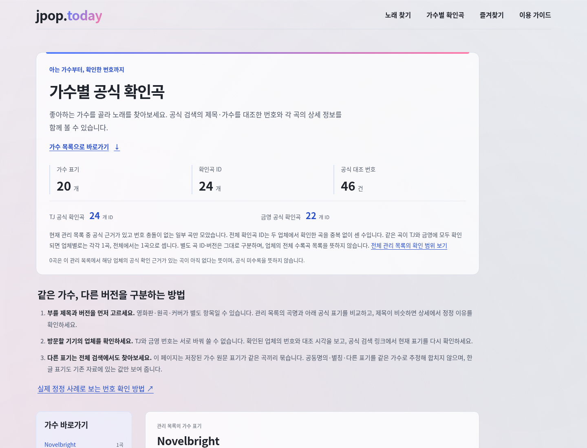
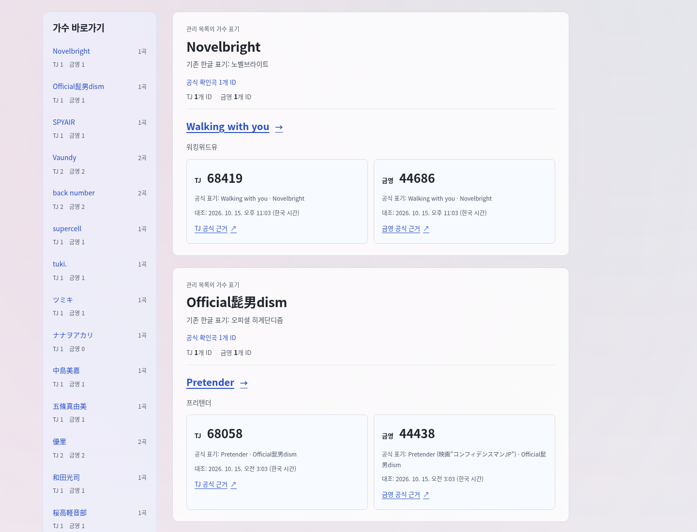
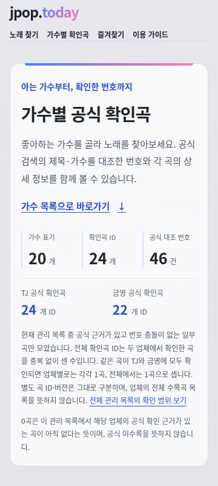
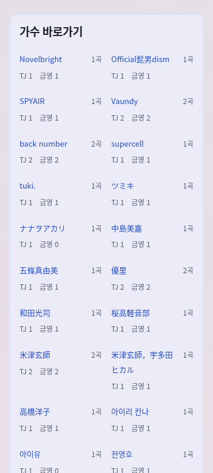
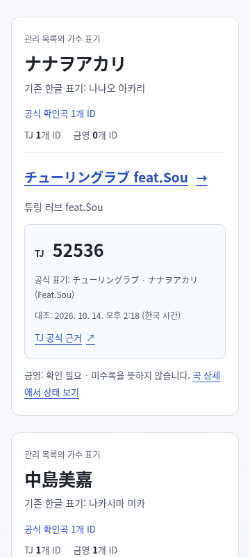
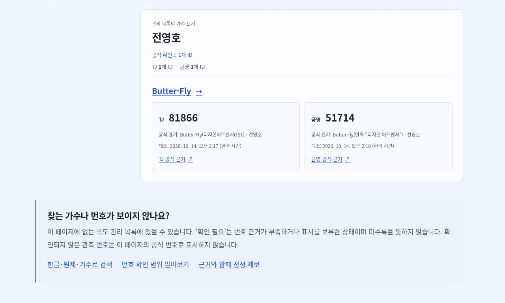

# 가수별 업체 확인곡 수 · 앱·디자인

작업 `resume-20261015-2300` / [Issue24](https://github.com/jpop-today/jpoptoday/issues/24) / DATA-001·CONTENT-001·SEO-001·DESIGN-001. 담당 `/root/resume23_app`, 단일 Git·공용 파일·빌드·서버·CI·배포 통합 담당 `/root`.

## 계약과 읽은 기준

- 소스 기준 `dffa93bc6982c9f186a269da577e3dbc108ad189`, 문서 기준 `daa79c0828ad6906461f88a6dc5edef36842fd73`, 조직 규칙 기준 `b7aad18fe2f793453b6505bb150f359d05ae3554`.
- branch `codex/24-provider-counts-20261015`.
- 소유 파일은 `jpoptoday/src/pages/artists.astro`와 이 문서뿐이다. Git 변경·서버 시작·package/lock·공용 CSS·계약·데이터·테스트·CI·배포는 수행하지 않는다.
- 세 저장소 `AGENTS.md`, `product/spec.md`의 Issue24 계약, `operations/status.md`, `roadmap.md`, `daily-development.md`, `continuous-development.md`를 읽었다. 기존 v0.4.1 완료 기록은 이번 변경의 배포 증거로 쓰지 않는다.

## 구현과 의미

`confirmedNumbers(song)`을 그대로 사용해 업체별 확인 가능한 `song.id`를 Set에 넣는다. 기존 current/playlist·provider-confirmed·공식 URL/근거·충돌 없음 판정은 바꾸지 않았다. 전역과 각 그룹의 TJ·금영 수치는 해당 Set의 크기이며, 전역 전체 확인곡 수는 두 업체의 ID 합집합이다. 예를 들어 같은 ID가 두 업체에서 확인돼도 전체는 1곡이다. `numberCount`는 두 업체 수 합이며 기존 ‘공식 대조 번호’ 요약으로 남긴다. 조사 성공 수를 미리 하드코딩하지 않는다.

화면은 상단에 업체별 공식 확인곡 수를, 가수 바로가기와 각 그룹 머리에 두 업체 수를 표시한다. 숫자는 SSR 본문에 있어 JS 없이도 보인다. 0은 ‘이 관리 목록에서 해당 업체의 공식 확인 근거가 있는 곡이 아직 없음’이며 공식 미수록이 아니라고 명시한다. 전체 수·업체 수·별도 버전 ID의 관계도 설명한다.

기존 가수 원문 그룹·공동명의 분리·anchor·곡 링크·공식 제목/가수/URL/대조 시각은 그대로 둔다. 새로 정정한 번호나 checkedAt를 앱이 만들지 않는다. 날짜·가수 약력·추천·음역·난이도·권리·Google 승인 주장을 추가하지 않는다.

가수 바로가기는 원문 이름/전체 곡 수와 업체별 수를 두 줄로 나누고 긴 원문을 줄바꿈한다. 업체 수로 늘어난 목록의 마지막 링크가 높은 데스크톱에서도 고정 내비게이션 아래에 갇히지 않도록 sticky를 해제했다. 모바일은 기존 두 열, 중간 폭은 세 열, 데스크톱은 왼쪽 목록 구조를 유지한다. 원래 blue `#4f7cff`→pink `#ff7aa8` 상단선과 기존 배경을 보존했으며 공용 CSS를 편집하지 않았다.

## DOM·접근성 규약

| 범위 | 규약 |
| --- | --- |
| 상단 업체 수 | `[data-provider-count="global"][data-provider="tj\|ky"]` |
| 가수 바로가기 수 | `[data-provider-count="index"][data-provider="tj\|ky"]` |
| 그룹 머리 수 | `[data-provider-count="group"][data-provider="tj\|ky"]` |
| 숫자 | 각 요소의 `data-count`는 0 이상 정수. 본문에도 실제 숫자를 표시한다. |
| 가수 바로가기 | `a[data-artist-index="기존 group.id"]`, href는 기존 `#group.id` |
| 기존 요약/그룹 | `data-directory="artists\|songs\|numbers"`, `section[data-artist-group][data-artist-name]` 보존 |
| 의미 연결 | 전역 `dl`·바로가기 `a`·그룹 `div[role="group"]`는 `aria-describedby="provider-count-note"`로 실제 0곡 안내와 연결. 바로가기의 수는 sr-only ‘개 공식 확인곡 ID’ 포함 |

## 검증 계획과 실제 상태

검증 흐름: `/artists/` → 가수 바로가기 키보드 Enter → 해당 가수 그룹의 두 업체 수/실제 근거 → 기존 곡 상세.

`frontend-testing-debugging` 스킬을 읽었다. Browser plugin/`browser` skill이 현재 없으므로 기존 Playwright와 시스템 Chromium으로 검사한다. 서버는 root가 준비한다. 새 브라우저 의존성은 설치하지 않는다.

구현과 `git diff --check`를 완료한 뒤 root가 준비한 첫 dirty preview를 독립 Playwright로 3viewport 관찰했다. 이 초기 artifact는 그룹 수 영역의 최종 `div[role="group"]` 변경보다 앞선 `p` 상태이므로 최종 소스/최종 배포 증거로 쓰지 않는다. 아래 최종 소스 관찰은 root 재빌드 뒤 같은 검사를 다시 수행한 결과다. 실제 배포 검증은 이 담당이 실행하지 않았다.

초기 임시 QA 스크립트는 앱 코드와 별개로 세 번 잘못된 기대/선택자 때문에 중단됐다. 처음에는 TJ URL의 실제 `nationType/strType/searchTxt/strWord` 대신 잘못된 `songNumber`를, 다음에는 KY 실제 `kygabang.com/chart/search_list.php?mode=SongSearch&val=` 대신 다른 도메인을 가정했다. 계약을 읽어 실제 URL/KOR namespace를 반영했다. 세 번째는 그라데이션이 있는 `.brand span` 대신 부모 `.brand`의 background를 읽어 `none`을 얻었다. 진단 스크립트만 정정했으며 제품을 기대값에 맞춰 바꾸지 않았다. 실패 JSON 3개와 최종 초기 관찰을 `/tmp/jpop-resume23-ui/`에 보존했다.

## 최종 소스의 실제 시각 QA

root가 최종 `div[role="group"]`를 포함해 재빌드한 뒤 `2026-10-15T14:12:35.324Z–14:12:39.894Z`(23:12:35–39 KST)에 같은 서버를 다시 관찰했다. 기존 Node24.19·Playwright·`/usr/bin/chromium`을 사용했다. 화면은 final source의 **dirty preview**이며 build-info의 sourceSha는 base `dffa93bc6982c9f186a269da577e3dbc108ad189`, `dirty:true`다. clean commit·CI artifact·원격 운영 결과와 구분한다.

| 검사 | 실제 결과 |
| --- | --- |
| viewport / JavaScript | 1440×1100 on, 360×800 off, 1280×768 on 모두 PASS |
| 페이지 정체성·본문 | `/artists/`, title ‘가수별 공식 확인곡 \| jpop.today’, h1·5,000자 이상 실제 본문 PASS |
| 독립 served-catalog 집계 | 매 viewport의 82개 global/index/group 수치가 일치. 원문20그룹, 합집합24곡 ID, TJ24·금영22; 업체 합46과 전체24를 구분 |
| 0곡 / 접근성 | ナナヲアカリ·아이유의 금영0을 확인. 모든 그룹 `role="group"`과 global/index/group의 `aria-describedby="provider-count-note"` 연결, 공식 미수록 아님 설명 PASS |
| 키보드 / 기존 URL | desktop/mobile에서 ナナヲアカリ 바로가기 focus→Enter→기존 anchor→チューリングラブ feat.Sou의 기존 안정ID 상세, short viewport는 마지막 전영호 anchor→Butter-Fly 기존 상세로 이동. 제목·실제 TJ 근거 링크 확인 |
| 시각 / 레이아웃 | 초기 화면·목록 상단·0곡 그룹·마지막 그룹 6PNG를 직접 열어 확인. 잘린 count/제목·가로 넘침·overlay 0, 실제 index static; 긴 공동명의의 모바일 줄바꿈 확인 |
| 브랜드 | computed `.brand span`·소개 상단선의 `rgb(79,124,255)→rgb(255,122,168)`와 body pink/mint/blue gradient 확인 |
| robots / canonical | `noindex, follow`, `https://jpop.today/artists/` PASS |
| 콘솔 / 요청 | 세 context의 console warning/error·pageerror·requestfailed·광고 요청 모두 0 |

관찰 artifact의 catalog hash는 `e01e4fe87769c251b209f5fb82bfb3f46b094ec5fee0bfe0768277f6ecd01ff0`, semantic ledger hash는 `3c51501c77400f62fc43aed5b99ab87a82933546f89f597fe02449b117b433c8`, semantic chart hash는 `971bacf9cb65e5b7176e8a5aa59394d2c46ce00d0676aa033178dc11ae7540b9`다. 페이지가 읽은 songCount3317/currentSongCount3313을 기록했다. 이 hash들은 pretty JSON 파일 bytes hash와 다르다.

임시 재현 스크립트 `/tmp/jpop-resume23-ui-qa-final.cjs`, 안전 결과 `/tmp/jpop-resume23-ui-final/qa.json`, PNG 6장은 같은 `-final/` 디렉터리에 있다. 파일명은 `desktop-summary.png`, `desktop-index.png`, `mobile-summary.png`, `mobile-index.png`, `mobile-zero-group.png`, `short-last-group.png`다. root가 [영속 QA JSON](../operations/runs/resume-20261015-2300-ui-qa.json)과 아래 `engineering/design/` 6PNG로 복사했음을 실제 파일 존재로 확인했다. 이 담당은 허용된 문서 한 파일 외에 docs artifact를 쓰지 않았다.

이 렌더 검사에서 WebKit/Firefox·실제 스크린리더·필드 성능·실제 광고/CMP·AdSense 계정·원격 배포/복구를 실행하지 않았다. 외부 공식 링크는 올바른 대상/표시를 확인했고 사이트에서 다시 요청하거나 광고를 클릭하지 않았다. 디스플레이 수치는 관리 목록 중 확인 근거가 있는 일부 곡의 범위다.

### 읽기 전용 통합 자료 점검

`node --test --test-isolation=none tests/reviewed-cohort-2300.test.mjs tests/provider-corrections.test.mjs`를 이 담당도 직접 실행해 **11/11 PASS·실패/skip0·197.96138ms**를 확인했다. root의 전체 unit 수나 별도 공식 조회 수에 중복 가산하지 않는다.

`2026-10-15T14:14:58.078318Z`에 Git의 base ledger를 읽어 기존63항목의 전체 객체·순서와 최상위 metadata가 같은지 독립 확인했다. 실제 저장된 request8·unreviewed candidate8·별도 decision8·append8의 ID/provider/번호/전체제목/가수/checkedAt/response hash가 일대일로 일치했다. 새 공식 요청을 보내거나 원문이 없는 응답의 hash를 재계산하지 않았다. 두 동료 평가는 이 읽은 파일과 실제 실행 범위에만 근거한다.

## 동료 읽기 평가

두 동료의 실제 소스/문서와 root의 `/tmp/jpop-2300-unit.txt`, `/tmp/jpop-2300-preview-e2e-final.txt`, `/tmp/jpop-2300-check-final.txt`를 읽었다. root 로그는 unit310/310·preview26/26(44.6초)·Astro0error/0warning/0hint다. 품질 담당 신규 2개 E2E의 처음 단위 문구 가정 오류와 이후 `role="group"` 추가/최종 재빌드 통과를 구분했다. root 소유 coverage의 과거 고정 count 실패2개는 동료 책임으로 점수화하지 않았다. production26·clean SHA CI·실제 배포/복구·Release는 이 평가 시점에 pending이며 읽지 않은 결과를 수용하지 않는다.

자료 담당은 전체63기존항목·상위metadata 보존과 실제 저장된 8candidate↔8decision↔8append의 일치를 독립 읽기로 확인해 할당 범위에 필수 보완이 없다. 추출 후보를 unreviewed로 보존하고 별도의 전체 제목/가수/버전 판단을 남긴 점을 수용한다. 원 응답이 없으므로 새 조회·원문 재파싱·hash 재계산을 했다고 쓰지 않는다.

품질 담당은 frozen cohort 증거·다른 동일 제목 가수 분리·비대상 객체/ID/URL 보존, 독립 served catalog와 모든 scope의 ID Set 비교·0설명·JS-off 키보드·role을 실제 검증했다. 현재 8행/현재 artifact에서 필수 보완은 없다. 비차단 유지보수 후속은 E2E의 독립 공식 URL 판정 규칙을 계약에 맞게 추적하는 일이다. 실제 계약 `officialLookupMatches`는 `www.kygabang.com`도 허용하지만 E2E predicate는 현재 `kygabang.com`만 인정하고, port/중복 query 키 조건도 계약과 다르다. 현재 모든 근거 URL은 실제 canonical 도메인/정상 query여서 결과에 영향이 없으며, 향후 유효한 URL 표기 추가 시 잘못된 회귀 실패를 막도록 별도 유지해야 한다. 독립 검증을 없애거나 현재 숫자 조건을 완화하라는 요청은 아니다.

```json
{
  "reviews": [
    {
      "reviewer": "/root/resume23_app",
      "candidate": "/root/resume23_evidence",
      "scores": { "correctness": 5, "evidence": 5, "value": 5, "maintainability": 5 },
      "criterionReasons": {
        "correctness": "동결차트11~14위의 실제current/playlist4ID·8번호를 전체제목/가수/버전으로 대조하고 confirm8만 append했다. base63전체객체/순서·상위metadata 불변, 저장candidate8↔decision8↔ledger8의 번호/제목/가수/checkedAt/hash 일치를 독립 읽기로 확인했다.",
        "evidence": "공식요청8개에 실제시각/HTTP200/요청=최종URL/응답bytes와hash·원unreviewed candidate 및 별도reviewer/reviewedAt/개별판단을 보존한다. 이 reviewer도 새cohort3+기존8계약을11/11실행했고 원문없음·hash재계산불가를 실제 한계로 구분했다.",
        "value": "Walking with you·ドライフラワー·水平線·踊り子의 실제8업체번호를 관측에서 근거있는확인으로 개선해 기존안정ID상세/가수목록에서 근거와대조시각을 볼 수 있게 한다. 미수록/음원동일성/권리/Google승인을 과장하지 않는다.",
        "maintainability": "안전helper를변경하지않고 지정ledger에append만 수행했다. metadata전용요청과별도decision·변경전후hash/원본보존·실행경계/다음root게이트를 문서와JSON으로 연결해 다음실행이 안전하게 추적할 수 있다."
      },
      "reason": "할당자료범위 수용. 기존63항목과 frozen입력을 보존하고 실제8개 근거의편집판단만 추가했으며 공식조회/후속CI·배포·AdSense 상태를 구분했다.",
      "evidence": [
        "jpoptoday/data/reviewed/provider-corrections.json",
        "docs/data/provider-review-20261015-2300.md",
        "docs/data/provider-review-requests-20261015-2300.json",
        "jpoptoday/data/staging/legacy-catalog.json",
        "jpoptoday/tests/reviewed-cohort-2300.test.mjs",
        "docs/engineering/artist-provider-counts-20261015-2300.md"
      ],
      "acceptance": "현재자료/검토/보존 범위 PASS·필수보완없음. 원문재파싱/새조회/배포/실제Google심사 수용을 뜻하지 않으며 cleanSHA CI·운영/복구/Release는 root의후속실제증거가 필요하다."
    },
    {
      "reviewer": "/root/resume23_app",
      "candidate": "/root/resume23_quality",
      "scores": { "correctness": 5, "evidence": 5, "value": 5, "maintainability": 4 },
      "criterionReasons": {
        "correctness": "고정63근거·8cohort의전체공식evidence·모든ID/URL/비대상객체·같은제목Ado분리를검증한다. E2E는앱집계helper없이servedcatalog에서global/index/group전체ID Set을산출해 TJ24/KY22/합집합24·0의미·role/aria·JSoff기존링크를 대조했다.",
        "evidence": "본인이직접새cohort3+기존8unit11/11을실행했고 root최종unit310/preview26/type0로그와두테스트소스/품질문서를읽었다. 초기단위표기가정2실패·초기p artifact·최종div role조건통과를 분리했으며 screenshot미실행을타담당실제6PNG로보완함을구분했다.",
        "value": "업체합46을24개ID와혼동하거나한가수의수를다른그룹에보이는회귀, 미확인0의미누락, 동일제목의다른가수근거전파 및JSoff키보드경로를 실제사용흐름에서검출한다. 기존원본/저장호환전체회귀를대체한다고쓰지않는다.",
        "maintainability": "고정cohort·독립집계를작은테스트로분리하고나중append도허용한다. 다만E2E의독립URL oracle은현재contract가허용하는www KY표기와port/query중복조건까지일치하지않아 향후공식URL표기변경때별도추적보완이필요하다. 현재실제8행은canonical URL이어서비차단후속이다."
      },
      "reason": "현재할당cohort/렌더검증 범위 수용. 실제통과/수정이력과root공용coverage실패책임을분리했고 숫자만맞추는구현동일테스트에그치지않았다. 독립URL oracle 유지보수후속을명시한다.",
      "evidence": [
        "jpoptoday/tests/reviewed-cohort-2300.test.mjs",
        "jpoptoday/e2e/artist-provider-counts.spec.ts",
        "docs/engineering/artist-provider-counts-quality-20261015-2300.md",
        "jpoptoday/contracts/provider-corrections.mjs",
        "/tmp/jpop-2300-unit.txt",
        "/tmp/jpop-2300-preview-e2e-final.txt",
        "/tmp/jpop-2300-check-final.txt",
        "docs/operations/runs/resume-20261015-2300-ui-qa.json"
      ],
      "acceptance": "현재cohort/preview수용 PASS·필수보완없음. 비차단URL oracle정합성후속을남기며 production/cleanSHA CI·원격배포/복구/Release는 pending으로구분한다."
    }
  ]
}
```

## 화면 증거

상단 전체/업체 수, 데스크톱 목록·근거, 모바일 두 열과 실제0군, 낮은 화면의 마지막 가수 도달을 각각 보여 준다. 6장 모두 이 담당이 열어 관찰했다.







