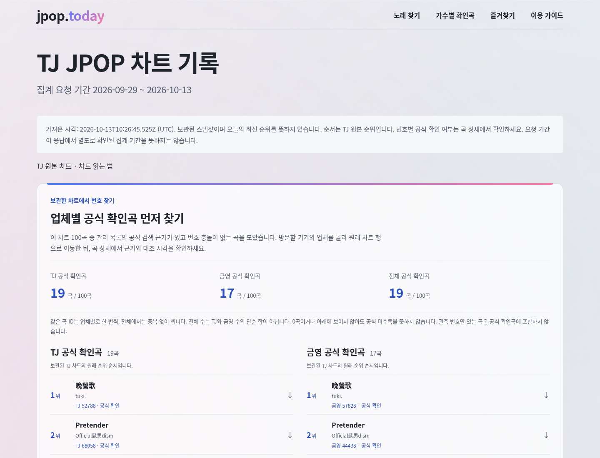
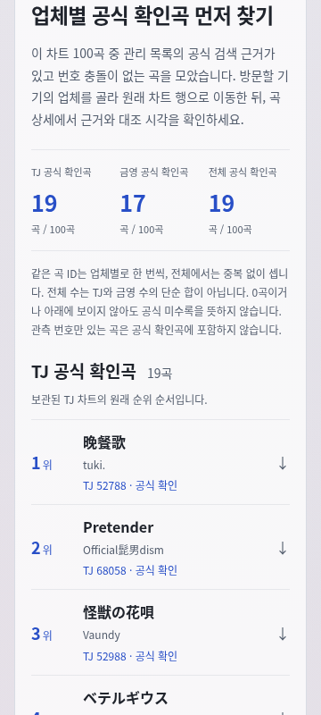
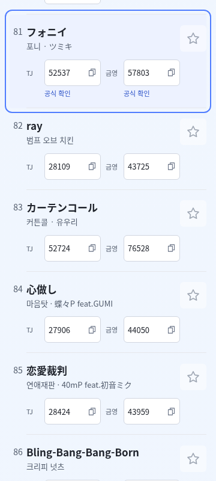
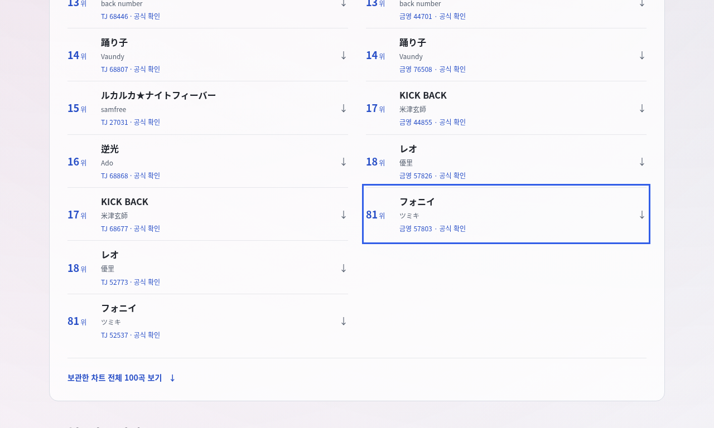

# 차트의 업체별 공식 확인곡 바로가기

작업: [Issue27](https://github.com/jpop-today/jpoptoday/issues/27) · `resume-20261016-0400` · CONTENT-001/DATA-001/SEO-001/DESIGN-001/HARNESS-001. 담당 `/root/resume04_app`, 통합·Git·공용 빌드·CI·배포는 root 한 명이다.

기준은 source `ce1b49f1ab6cedb64dca7cd2b215e72aafc76e50`, docs `5d1964dfeacdad5c6b2c81d2522ce3aadb83de05`, branch `codex/27-chart-confirmed-20261016`이다. 소유 파일은 `jpoptoday/src/pages/chart.astro`와 이 문서뿐이다. [제품 계약](../product/spec.md)의 Issue27과 [실행 계약](../operations/runs/resume-20261016-0400.json)을 읽었다. 번호 ledger는 별도 근거 담당 소유이므로 이 구현은 신규 확인 수를 가정하거나 고정하지 않는다.

## 사용자 행동과 구현

검증할 흐름은 `/chart/` → TJ 또는 금영의 원래 순위 순서 바로가기 → 안정 ID에 연결된 기존 차트 행 → 기존 곡 상세의 공식 근거·실제 대조 시각이다.

- 기존 100곡 검증과 `chart.songs`의 순서·canonicalId join, 요청 기간·fetchedAt·보관 스냅샷/응답 기간 경계 안내, 출처 URL과 가이드를 보존했다. 차트 순위와 확인 상태는 별개다. 금영 목록의 순위도 기존 TJ 차트 순위이며 금영 자체 순위를 생성하지 않는다.
- 기존 `confirmedNumbers` 계약을 그대로 사용한다. current/playlist, provider-confirmed, conflict:false와 실제 근거/공식 numeric URL 조건을 만족하는 업체만 바로가기에 포함한다. 관측값으로 확인을 추정하지 않는다.
- 업체별 고유 ID 수와 두 업체의 합집합 수를 100곡 분모와 함께 서버에서 렌더한다. 같은 ID는 업체별 한 번, 전체 한 번이며 전체 수는 업체별 수의 단순 합이 아니다. 0이나 바로가기 부재는 공식 미수록을 뜻하지 않는다는 설명을 연결했다. 0일 때 빈 목록의 뜻을 정적으로 안내한다.
- 새 fragment는 순위가 아닌 `chart-${stableSongId}`다. 원래 `.chart-entry`에 fragment와 `tabindex=-1`만 추가하고 내부 `SongRow`·상세 링크·번호/저장 구현은 수정하지 않았다. 고정 위치 패널과 새 클라이언트 코드·의존성은 추가하지 않았다.
- TJ/금영을 큰 화면에서 두 열, 좁은 화면에서 한 열로 두고 제목·가수·확인 업체/번호·원래 순위를 제공한다. 바로가기와 전체 목록 사이에는 원래 차트 100곡으로 이동하는 native anchor가 있다. 긴 제목은 줄바꿈하며 표본을 잘라 숨기지 않는다.
- 공용 CSS를 수정하지 않았다. 기존 blue `#4f7cff` → pink `#ff7aa8` 그라데이션을 새 구역 상단에 재사용하고 body의 pink/mint/blue 배경을 보존했다. 링크는 기존 짙은 blue `#284fc7`, 본문 보조색 `#535d6d`이며 실제 대비/크기와 360px 넘침 여부는 브라우저 QA에서 확인한다.

## 검증과 증거 경계

2026-10-15T19:08:10Z(10월16일04:08KST) 기준 코드 구현 후 정적 검토를 끝냈다. 당시에는 root의 최종 빌드·공유 서버가 제공되지 않아 타입/빌드·실제 렌더·스크린샷·브라우저가 대기 상태였다. 이후 실제 결과는 아래에 분리했다. 공용 dist race를 피하려고 이 담당은 독자 빌드나 서버를 시작하지 않았다.

`frontend-testing-debugging` 스킬을 읽고 적용했다. 도구·스킬 목록에 Browser plugin과 browser skill이 없어 `Browser plugin not available`로 분류했다. root의 최종 서버가 준비되면 기존 Playwright와 system Chromium을 사용하며 새 브라우저 의존성은 설치하지 않는다. QA 임시 파일은 `/tmp`에 두고 필요한 영속 증거만 root가 docs에 복사한다.

예정 검사는 데스크톱·360×800 JS off·짧은 데스크톱의 페이지 title/URL·본문·overlay·console/request/광고 요청·preview noindex·brand/palette·가로 넘침/잘림·Tab/Enter→fragment→상세·마지막 바로가기 접근이다. 테스트 기대 수는 served catalog와 frozen chart를 독립적으로 계산한다. 실제 결과와 실행 시각·대상 build metadata·실패가 생기면 아래에 추가한다.

같은 SHA CI·실제 Cloudflare 미리보기·전체 재현 빌드·실제 복구/재적용·운영 배포·릴리스는 root의 별도 게이트다. 이 문서는 UI 코드 작성만으로 그 결과나 AdSense 승인·권리·난이도·최신 차트를 만들지 않는다.

## 실제 UI QA

root가 제공한 첫 dirty preview는 `http://127.0.0.1:4321`, source base `ce1b49f1ab6cedb64dca7cd2b215e72aafc76e50`/`dirty:true`였다. root의 3,347files/3,336HTML/preview0index 빌드이며 이 담당은 그 서버에만 연결했다. 빌드·서버·Git을 따로 조작하지 않았다.

첫 임시 검사에서는 desktop에서 native anchor→행 focus→Tab으로 기존 상세 링크 focus까지 진행했지만, 마지막 Enter 직후 URL을 동기적으로 읽어 navigation 완료 전에 실패했다. 이는 QA script의 대기 누락이다. 원 실패 `/tmp/jpop-resume04-ui/qa.json`을 [첫 실패 영수증](../operations/runs/resume-20261016-0400-ui-first-qa.json)으로 보존하고 앱 수정 없이 `waitForURL`과 Enter를 함께 기다리도록 고쳤다.

`2026-10-15T19:12:10.951Z–19:12:16.577Z`의 수정된 임시 QA `/tmp/jpop-resume04-ui/final/qa.json`은 1440×1100/360×800 JS off/1280×768에서 독립 계산 TJ19·금영17·합집합19/분모100·순위순 바로가기/번호·원래100곡/URL·동결안내·preview noindex·native keyboard·광고 요청/콘솔0을 통과했다. **이 자동 PASS는 최종 UI 수용이 아니다.** screenshot을 직접 읽어 360px 기존 차트행의 공식확인 badge와 금영 라벨이 겹치고 badge가 세로로 찌그러지는 실제 렌더 결함을 발견했다. [수정 전 자동검사 영수증](../operations/runs/resume-20261016-0400-ui-before-fix-qa.json)과 [실제 결함 이미지](../operations/runs/resume-20261016-0400-ui-before-fix-mobile-anchor.png)를 보존했다. 가로 overflow 검사만으로 이 겹침은 검출하지 못했다.

root와 소유권/재빌드를 조율하고 `2026-10-15T19:13:42Z`에 `chart.astro` 안의 페이지 한정 CSS만 수정해 재freeze했다. 모바일 두 업체 번호셀을 각각 절반 폭의 label/button grid로 분리하고 badge를 아래 줄로 옮겨 줄바꿈 없이 읽도록 했다. 번호 복사 버튼과 저장 버튼은 44px hit target을 제공한다. 바로가기 순위 숫자와 ‘위’도 한 줄로 유지한다. 공용 `SongRow`·global CSS·자료·URL·복사/저장 코드는 그대로다.

앞선 dirty artifact는 이 수정 전 결과다. root가 기존 소유 서버 종료→새 빌드/산출물 검사→서버 재시작을 마친 후 새 3viewport·셀/badge 비중첩·44px hit target과 screenshot을 검증해야 최종 UI 결과를 수용할 수 있다. 재검사 영수증은 기존 실패/첫 자동 PASS와 분리해 기록한다.

### 수정 후 실제 결과

root는 이전 소유 서버를 종료한 뒤 수정 포함 preview를 다시 빌드·`verify:dist`하고 `http://127.0.0.1:4321` 새 소유 서버를 인계했다. 이 담당은 `2026-10-15T19:15:18.515Z–19:15:24.787Z`(10월16일04:15KST)에 최종 dirty preview를 별도 `/tmp/jpop-resume04-ui/final2/`로 검증했다. 세 viewport의 build-info는 preview/source `ce1b49f1ab6cedb64dca7cd2b215e72aafc76e50`/`dirty:true`/catalog semantic `742a490b8a6f2f0f2e45ae3663c6f659c959bd112391f0b25fa70d50f6bfe2d3`/ledger semantic `13bfed1c4382365f9dfdd7b548a8874cc680de196772f0767eaec87a5a6743c3`/chart semantic `971bacf9cb65e5b7176e8a5aa59394d2c46ce00d0676aa033178dc11ae7540b9`로 같았다. 이는 root 후속 clean SHA·실제 배포 검사와 구분한다.

| 검사 | 실제 결과 |
| --- | --- |
| 환경 | 1440×1100 JS on, 360×800 JS off, 1280×768 JS on · system Chromium `/usr/bin/chromium` · Browser plugin not available |
| 페이지 정체성/본문 | `/chart/`, title `TJ JPOP 차트 기록 \| jpop.today`, h1/SSR 본문·정확한 canonical PASS |
| 원100곡/공식 확인 | served catalog와 frozen chart 독립 계산 TJ19/금영17/합집합19/분모100; 모든 원100ID·순위·기존 상세URL와 각 바로가기 ID/순위/제목/가수/확인번호·설명 연결 정확 일치 |
| 동결 경계 | 기존 요청 기간/fetchedAt/최신순위 아님/응답 집계기간과 구분·0≠미수록·합집합 설명 PASS |
| 모바일 실결함 회귀 | 100행의 두 업체 cell/label/button/badge bounding box 비중첩; 181번호버튼 최소94×44px, 100저장버튼44×44px, 44badge 최대높이16px·단일행/업체셀 안에 표시 |
| 키보드 상호작용 | 각 viewport 마지막 금영81위 바로가기 focus→Enter→동일 stable 행 focus(상단24px)→Tab→원래 상세링크→Enter→동일 제목/기존 공식근거URL PASS. 마지막 바로가기 중앙 hit target과 화면 내 접근 가능, 고정 패널 가림 없음 |
| 브랜드/시각 | 기존 blue/pink 그라데이션과 pink/mint/blue body computed style 일치; 가로 넘침 없음. desktop-first/mobile-summary/mobile-anchor/short-last-shortcut screenshot을 실제 열어 원 badge 충돌·세로 찌그러짐과 순위 ‘위’ 줄바꿈 해소 확인 |
| 선택 텍스트 대비 | QA computed style/해당 CSS의 foreground와 실제 screenshot의 인접 빈 배경 pixel에 WCAG sRGB 상대휘도식 적용: summary blue6.52:1, scope muted6.23:1, 행의 확인 badge blue6.18:1. 선택한 표본만이며 사이트 전체 접근성 감사로 확대하지 않음 |
| 오류/광고/색인 | 각 viewport framework overlay/pageerror/console error·warning/request failed/광고 요청0, preview noindex. 광고 markup의 독립 자동 검사는 품질 E2E/root 결과에 별도 연결 |

명령은 기존 dependency의 Playwright를 import하는 임시 `/tmp/jpop-resume04-ui-qa.mjs`에 정확한 root 서버 URL와 새 출력 경로를 인자로 주었다. 실제 요청은 공개 artifact metadata/catalog와 사이트 본문뿐이며 공식 제공사 추가 조회는 0회다. 기존 proxy/CA를 해제하거나 dependency를 설치하지 않았다. 광고 도메인 요청이 생기면 차단·실패로 기록하는 route를 두었고 실제 해당 요청은 0회였다. root가 최종 [3viewport·100행 bbox 영수증](../operations/runs/resume-20261016-0400-ui-qa.json), [선택 대비 영수증](../operations/runs/resume-20261016-0400-ui-contrast.json)과 12PNG를 영속 복사했고 아래 실제 경로를 확인했다. 원 실패/첫 자동 PASS/실제 시각적 결함과 수정 후 수용은 모두 보존한다. 08:04KST의 같은 run 재개 후 이 문서·증거 경로를 마무리했으며 새 worker/브라우저/빌드/서버/Git을 실행하지 않았다.

남은 범위는 WebKit/실제 기기·스크린리더·사이트 전체 대비 감사와 root의 clean CI/원격 preview/실제 복구·운영/Release다. 이번 UI 검사는 그 결과나 Google 실제 심사를 대신하지 않는다.

### 최종 화면 증거

아래 네 이미지는 이 담당이 실제 열어 확인한 수정 후 대표 화면이다. 나머지 8개도 동일 디렉터리의 같은 prefix로 보존했다: desktop의 summary/last-shortcut/anchor, mobile의 first/last-shortcut, short의 first/summary/anchor.






## 다른 두 산출물에 대한 읽기 전용 평가

`2026-10-15T23:11:00Z`(16일08:11KST) 같은 run에서 다른 두 담당의 최종 파일과 root 실제 로컬 로그를 읽었다. 별도 공식 조회·raw 응답 재파싱·Git/빌드/서버/브라우저를 실행하지 않았다. 저장된 안전 metadata의 request8/candidate8/decision8과 ledger append6·보류2의 ID/번호/전체 제목·가수/URL/checkedAt/hash/이유를 읽기 전용 Python으로 직접 대조했고 원71개 전체/순서·최상위 metadata 일치와 canonical hash를 확인했다. 이는 요청 당시 raw 응답의 독립 재계산이 아니다.

root의 `/tmp/jpop-0400-unit.txt` 314/314·14,489.143116ms, check-final 0errors/0warnings/0hints, preview-e2e-after-jsonfix 28/28·50.3s와 production-e2e 28/28·50.5s를 실제 읽었다. 새 E2E는 각 target에서 실제 두 검사 PASS이며 첫 Node24 JSON import 수집 실패 로그의 `needs an import attribute of "type: json"`와 현재 `readFileSync(new URL(...))` 정정을 함께 확인했다. type0이 e2e 수집 성공을 대신하지 않으며 원 실패를 지우지 않았다. 자료·품질 산출물은 이 로컬 통합 범위에서 둘 다 수용한다. 변경량/말수·해결된 실패의 존재만으로 차등 점수를 만들지 않는다. 같은 SHA clean CI·실제 원격 preview/복구/운영/Release 게이트는 아직 pending이다.

```json
{
  "reviews": [
    {
      "reviewer": "/root/resume04_app",
      "candidate": "/root/resume04_evidence",
      "scores": {
        "correctness": 5,
        "evidence": 5,
        "value": 5,
        "maintainability": 5
      },
      "criterionReasons": {
        "correctness": "실제 metadata의 전체 제목·명의·부제를 frozen chart canonicalId와 대조해 TJ samfree/Ado 및 TJ·KY KICK BACK/レオ 6개만 confirm했다. SAM과 samfree 별칭 동일성을 추정하지 않았고 생략된 KY 역광 제목도 재구성하지 않아 2개 observed를 유지한다. 원71개 전체·순서·최상위 metadata, 동결100행·3317ID/번호/URL/unknown을 직접 대조한 범위에서 보존한다.",
        "evidence": "request8의 HTTP200/정확한 final URL·실제 checkedAt/bytes/hash·unreviewed candidate와 별도 reviewer/reviewedAt/decision8을 실제 읽었다. 각 confirm6의 ledger evidence/이유와 보류2의 ledger 부재를 직접 비교했고 root evidence-audit 및 314unit 결과와 일치했다. 저장하지 않은 rawbody의 재파싱·hash 재계산이나 추가 공식 조회를 했다고 주장하지 않는다.",
        "value": "공식 확인 근거 6번호를 실제 4곡 ID에 보강해 차트 TJ19/금영17/합집합19의 안전한 업체 탐색을 제공할 수 있다. 불명2번호는 관측으로 남겨 잘못된 업체 확인을 피하며 같은 제목·명의/버전을 구분할 수 있는 실제 근거를 보존한다.",
        "maintainability": "기존 검증된 metadata-only helper를 변경하지 않고 ledger 끝에만 6개를 append했다. 요청·후보·편집 결정·public projection 경계를 분리하고 원본 hash·제한·다음 검토 대상·자료권리/Google unknown을 문서화하여 이후 검토가 이전 근거를 덮어쓰지 않고 이어갈 수 있다."
      },
      "reason": "정체성·버전 근거가 확보된 경우와 부족한 경우를 명시적으로 나눴고, 저장된 실제 metadata/별도 결정/ledger와 원본 보존을 직접 확인했다. 로컬 통합 수용이며 공식 raw 응답 재검증·배포·Google 승인 수용으로 확대하지 않는다.",
      "evidence": [
        "/workspace/jpoptoday/data/reviewed/provider-corrections.json",
        "/workspace/docs/data/provider-review-20261016-0400.md",
        "/workspace/docs/data/provider-review-requests-20261016-0400.json",
        "/workspace/docs/operations/runs/resume-20261016-0400-evidence-audit.json",
        "/tmp/jpop-0400-base-ledger.json",
        "/tmp/jpop-0400-unit.txt"
      ],
      "acceptance": "accepted_for_local_integration; same-SHA remote CI/preview/recovery/production/Release pending"
    },
    {
      "reviewer": "/root/resume04_app",
      "candidate": "/root/resume04_quality",
      "scores": {
        "correctness": 5,
        "evidence": 5,
        "value": 5,
        "maintainability": 5
      },
      "criterionReasons": {
        "correctness": "4개의 cohort unit이 원71 전체/동결 bytes/3317ID·URL/비대상 provider와 정확한6 evidence·보류2 observed 상태를 검증한다. 새2 E2E는 UI 집계 helper를 import하지 않고 served catalog·동결 chart로 100행/순위/ID/기존URL·TJ/KY/합집합/분모100을 계산하며, 관측·충돌·chart-only를 확인곡으로 섞지 않는다.",
        "evidence": "실제 소스와 root 로그에서 314unit/type0·preview28/production28 PASS를 읽었고 두 target에서 새 SSR/mobile 검사가 각각 실제 실행된 것을 확인했다. 초기 Node24 JSON import 수집 실패와 readFileSync 정정/--list/최종 통과를 분리한다. 본인 browser 실행이 아닌 앱 QA12PNG/JSON 읽기 범위 및 실제 운영/CI 미실행을 정확히 기록한다.",
        "value": "JS off 360px의 focus/Enter→마지막 TJ·첫 금영 anchor→기존 상세·공식 URL과 100행 provider label/button/badge bbox를 검사한다. 실제 screenshot에서 발견한 내부 겹침·세로 badge를 가로 overflow PASS만으로 놓치지 않게 영속 회귀에 추가하여 사용자가 업체 번호를 혼동하는 결함을 잡는다.",
        "maintainability": "UI 집계와 독립된 기대 계산을 유지하면서 공식 numeric URL 자격만 기존 ledger 계약을 재사용해 www금영/port/중복·추가query 규칙의 oracle 차이를 만들지 않는다. 이후 독립검토 cohort append를 허용하고 보류 번호의 미래 정상 승격을 영구 금지하지 않으며, JSON 읽기 정정은 package/config 변경 없이 소유 테스트에 한정했다."
      },
      "reason": "근거 보존과 실제 렌더 결함에 연결된 의미 있는 unit/E2E이며 로컬 실제 전체 결과를 확인했다. 해결된 초기 수집 실패는 보존했고 점수를 억지로 낮출 미해결 결함은 이 범위에서 찾지 못했다. 원격 게이트는 별도 수용이다.",
      "evidence": [
        "/workspace/jpoptoday/tests/reviewed-chart-cohort0400.test.mjs",
        "/workspace/jpoptoday/e2e/chart-confirmed-navigation.spec.ts",
        "/workspace/docs/engineering/chart-confirmed-quality-20261016-0400.md",
        "/workspace/docs/operations/runs/resume-20261016-0400-ui-qa.json",
        "/tmp/jpop-0400-unit.txt",
        "/tmp/jpop-0400-check-final.txt",
        "/tmp/jpop-0400-preview-e2e-final.txt",
        "/tmp/jpop-0400-preview-e2e-after-jsonfix.txt",
        "/tmp/jpop-0400-production-e2e.txt"
      ],
      "acceptance": "accepted_for_local_integration; same-SHA remote CI/preview/recovery/production/Release pending"
    }
  ]
}
```
