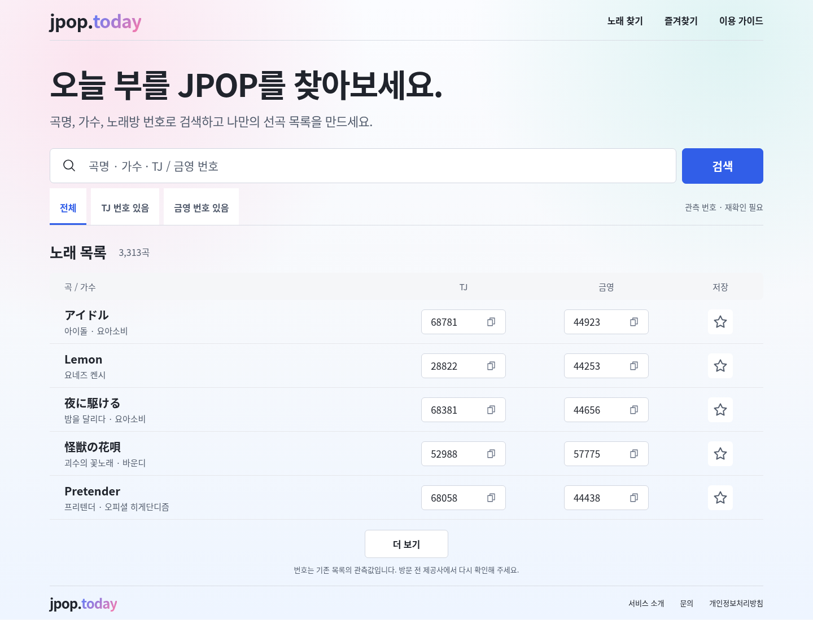
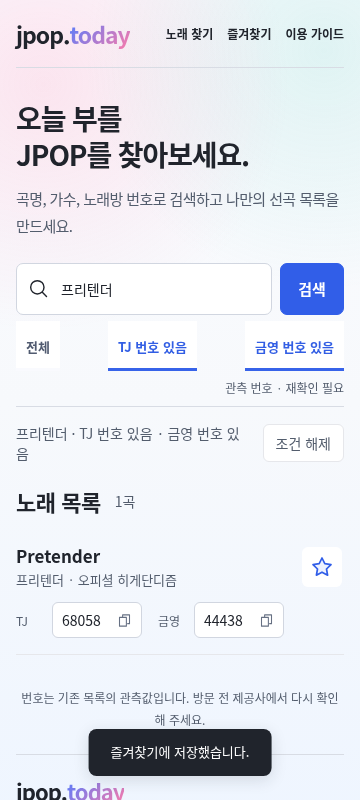
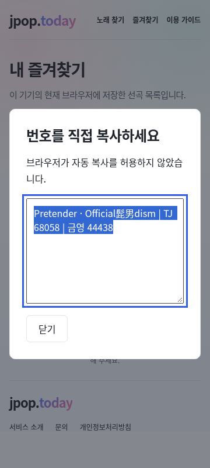

# 미리보기 독립 UI QA · 2026-10-14

[Issue #9](https://github.com/jpop-today/jpoptoday/issues/9) · DESIGN-001, SEARCH-001, FAVORITES-001, RELEASE-001 · [제품 스펙](../../product/spec.md) · [ADR-004](../../adr/004-observed-preview-read-model.md).

## 결론과 발견

동일 source SHA의 로컬 빌드에서 원본 팔레트, 1440×1100·360×800 검색/저장 흐름과 화면 대조를 독립 검증했다. 핵심 흐름은 통과했다. 실제 Cloudflare 미리보기의 HTTPS HTTP 확인도 통과했으며, 원격 브라우저 렌더링은 이 담당자가 실행하지 않았다. 발견한 favicon 오류는 관리자가 후속 0.2.1 코드에서 수정했고, 이 담당자의 새 로컬 브라우저 확인으로 해소를 검증했다. 후속 clean commit·CI·배포는 그 로컬 검증과 별도다.

경미한 사항 하나를 발견했다. 0.2.0의 새 Chromium 세션에서 홈을 열면 `/favicon.ico`가 404여서 desktop 콘솔에 네트워크 error 한 건이 남는다. CDP `Log.entryAdded`와 `Network.responseReceived`, 콘솔 location이 같은 URL을 가리켰다. 실제 미리보기 `/favicon.ico`도 404였다. 검색·저장·복사 흐름의 JavaScript `pageerror`는 0이며 기능 차단은 관찰하지 않았다. P3 개선으로 통합 담당자에게 인계했고, 아래 후속 로컬 검증에서 수정 해소를 확인했다. 이 작업의 소유 범위가 QA 문서 한 파일이므로 앱 수정은 관리자가 수행했다. 원래 불변 0.2.0 미리보기의 콘솔 전체가 오류 0이라고 기록하지 않는다.

## 작업 계약과 환경

| 항목 | 값과 실행 주체 |
| --- | --- |
| 담당 / 통합 | `/root/daily_20261014_ui` / `/root` |
| 소유 파일 | 새 `engineering/design/preview-20261014-qa.md` 한 파일; 앱·기존 문서·Git·package·workflow 변경 없음 |
| 문서 기준 | `5c3faaca5a77d3fd16cef865db98c68a7c204eed`, `codex/daily-development-20261013`; 공유 체크아웃의 다른 담당자 변경은 건드리지 않음 |
| 검증 artifact source SHA | `2beb1bf02ec2aa67161cd16e77ed96b18bbf580e`; 시작 시 source HEAD와 clean 상태, 로컬/원격 `build-info.json`의 `dirty:false` 확인 |
| 로컬 | `http://127.0.0.1:4321`, 기존 `dist`를 `scripts/serve-preview.mjs`로 제공; 다른 담당자의 후속 source 변경을 재빌드하지 않음 |
| 실제 미리보기 | [92a25483.jpoptoday-preview.pages.dev](https://92a25483.jpoptoday-preview.pages.dev); 관리자가 배포한 불변 URL을 직접 HTTP 확인 |
| 시각 / 런타임 | 2026-10-14 00:06–00:07 UTC / 09:06–09:07 KST; Node 24.19.0, 기존 `/usr/bin/chromium`, 기존 Playwright 1.64.0 |
| 화면 크기 | desktop 1440×1100, mobile 360×800 |
| Browser 경로 | Browser plugin not available. [frontend-testing-debugging 스킬](skill://plugins~Plugin_d0e159446ee48191b94ce1960780cc3c/frontend-testing-debugging/SKILL.md)의 Playwright fallback 사용, 신규 패키지 설치 없음 |
| 원격 HTTPS 경로 | Playwright `APIRequestContext`, 상속된 `HTTPS_PROXY`와 기존 Node CA trust 유지. TLS 검증 활성; `ignoreHTTPSErrors`·인증서 우회·영구 CA 신뢰 변경 없음 |
| 결과 SHA | 작업자 commit 없음. 문서 최종 SHA는 통합 담당자가 기록 |

일반 sandbox의 loopback 요청은 `EPERM`이었다. 네트워크 추가권한으로 재시도한 결과 `ECONNREFUSED`를 확인하고 기존 서버를 시작했다. 이는 로컬 실행 권한의 차이이며 앱 결함으로 분류하지 않았다. 기존 원격 Chromium 경로는 proxy CA의 NSS trust 미설정 제약이 보고되어 있으며, 이 담당자는 조건 변화 없이 반복하거나 TLS 검증을 우회하지 않았다.

## 브라우저 확인

확인 흐름: `/` → 키보드 검색 → 번호 조건과 URL 복원 → 키보드 저장 → `/favorites/` → 번호 목록 복사 fallback → 저장 해제 → 결과 없음 → 조건 해제와 뒤로가기.

| 확인 | 결과와 독립 실행 근거 |
| --- | --- |
| 페이지 식별 / 의미 있는 본문 | PASS. `/`, `오늘 부를 JPOP 찾기 \| jpop.today`, 한국어 h1, 현재 `3,313곡`, 최초 5행 확인 |
| 빈 화면 / framework overlay | PASS. `data-app-ready=true`, 실제 본문과 캡처; Vite/Astro/Next overlay 요소 0 |
| 콘솔 | 조건부 통과. desktop 최초 favicon network error 1, mobile error 0; 양쪽 `pageerror=0`, warning=0, 앱 요청 실패=0. 별도 CDP 재현으로 favicon 원인을 특정 |
| 한글 / 원제 / 가수 결합 / 번호 검색 | PASS. `프리텐더`→1곡, `Pretender`→2곡, `Official Pretender`→1곡, `68058`→1곡. 일본어 `アイドル`→6곡, `YOASOBI アイドル`→1곡; 원제 부분 검색 결과를 임의로 단일 곡이라고 쓰지 않음 |
| 필터 / 주소 복원 | PASS. 한글 검색 후 TJ와 금영 모두 선택, `number=has-tj&number=has-ky`, reload 후 검색어와 두 `aria-pressed=true` 복원 |
| 저장 / 기존 키 | PASS. Pretender 저장 버튼 focus 후 Space, 선택 상태와 파란 별 확인; `jpop_today_favorites`에 기존 안정 ID 하나 저장. 즐겨찾기 이동 시 1곡, Space로 해제 후 0곡·저장 배열 `[]` |
| 복사 fallback | PASS. clipboard 거부를 QA에서 주입. 즐겨찾기 번호 목록 복사→dialog→선택된 textarea focus; TJ `68058`, 금영 `44438` 포함. 닫기 후 dialog 숨김. 360px dialog x=16, width=328 |
| 검색 실패 복구 / 뒤로가기 | PASS. 없는 검색어→0곡과 안내; 조건 해제→3,313곡; 뒤로→원래 검색어·0곡 복원 |
| 키보드 / focus | PASS. Tab 순서가 skip link→브랜드→주요 메뉴 3개→검색. 검색 wrapper `rgb(49,94,232) solid 2px`, offset 2px. Enter 검색과 Space 저장/해제 동작 확인 |
| 반응형 / clipping | PASS. 최초·검색/저장·빈 결과/뒤로 상태 `documentElement.scrollWidth`가 각각 1440/360. mobile 업체명·번호·저장 분리, dialog 화면 안 배치. 실제 캡처를 `view_image`로 검토 |

저장한 곡의 ID는 `jpop-playlist-official髭男dism-pretender-89fe1cbab6`였다. 로컬 읽기 모델의 관측 번호를 검증한 것이며 공식 제공사 확인 완료로 승격하지 않는다. 손상 storage·quota·legacy ID의 상세 회귀는 기존 E2E와 관리자 실행 결과에 남겨 두고, 이 담당자 실행으로 중복 주장하지 않는다.

## 원본 팔레트와 이전 화면 대조

[원본 그라데이션 기록](legacy-gradient.md)과 [전일 QA](daily-20261013-qa.md)를 읽고 실제 원본 `/tmp/jpop-original-audit/css/style.css`와 현재 `src/styles/global.css`를 대조했다. 원본 CSS SHA-256은 `43565ca0247914cae66afe5a403887a599115ae9153d2748c7cbc68ece6a7fd2`, 현재 CSS는 `ff5c98214a712c285f3f211300e82843bd532c36b57b87259abb9c8ab8c6a134`로 전일 기록과 일치했다.

| 기준 / 실제 렌더링 | 처리와 증거 |
| --- | --- |
| 원본 pink/mint radial + 3-stop linear body | 공백 정규화 후 원본 선언과 같음. 두 viewport computed style의 `rgba(255,122,168,.18)` / `rgba(77,199,183,.16)` / `#fbfcff→#f7f9fc→#eef5ff` 확인 |
| 원본 blue/pink 브랜드 | computed `linear-gradient(135deg,rgb(79,124,255),rgb(255,122,168))`; header/footer 캡처 확인 |
| 원본 강조 / hover / 저장 배경 | `#315ee8` / `#284fc7` / `#edf2ff` 원본 토큰과 같음. 실제 검색 버튼·선택된 저장 별 색과 fill 확인 |
| 루트 / 브라우저 테마 색 | computed `#f7f9fc`, meta theme-color `#f7f9fc` |
| 전일 desktop 같은 최초 상태 | 전일 `/tmp/jpop-daily-qa/desktop.png`와 새 `desktop-initial-full.png`, 모두 1440×1107. RGB pixel difference bounding box `None`, 차이 0 |
| 전일 mobile 같은 한글 검색 상태 | 전일 `/tmp/jpop-daily-qa/mobile.png`와 새 `mobile-prior-matched.png`, 모두 360×848. 같은 검색 focus·필터 미선택·미저장 상태로 맞추어 RGB pixel difference bounding box `None`, 차이 0 |
| 검색+두 필터+저장 / 복사 dialog | 새 상호작용 상태만 별도 캡처. 상태가 다른 이미지를 전일과 직접 pixel 비교하지 않음 |

desktop container x=88, width=1264 / mobile x=16, width=328을 실제 DOM에서 기록했다. 대조한 같은 상태의 화면에서 색·배치·타입 변경은 발견하지 않았다. 시스템 폰트가 다른 환경이나 다른 브라우저의 동일 픽셀을 보장하지 않는다.

WCAG 상대 휘도식으로 독립 재계산했다. 선형 배경 3 stop마다 mint alpha 0/.16, pink alpha 0/.18을 순서대로 합성한 보수적 조합의 최솟값이며, 개별 화면의 픽셀 측정값으로 설명하지 않는다.

| 전경 / 배경 | 대비 |
| --- | ---: |
| 본문 `#20242c` / 보수적 그라데이션 | 11.18:1 |
| 보조 글자 `#535d6d` / 보수적 그라데이션 | 4.78:1 |
| 본문 링크 `#284fc7` / 보수적 그라데이션 | 4.97:1 |
| 흰 글자 / 검색 `#315ee8` | 5.39:1 |
| 흰 글자 / hover `#284fc7` | 6.92:1 |
| 저장 별 `#315ee8` / `#edf2ff` | 4.81:1 |
| 파란 focus `#315ee8` / 보수적 그라데이션 | 3.87:1 |

일반 글자는 4.5:1, 해당 UI/focus는 3:1 이상이었다. 브랜드 로고 그라데이션·disabled 컨트롤을 위 일반 글자 수치에 포함하지 않았다. 전체 접근성 감사 완료를 의미하지 않는다.

## 실제 원격 HTTP 증거

18개 경로와 실제 홈 HTML이 참조한 CSS/JS 2개, 총 20개를 HTTPS로 직접 요청했다. 추가 favicon 요청은 위 발견 재현용으로 분리했다.

| 대상 | 관찰 |
| --- | --- |
| `/`, `/search/`, `/favorites/`, `/chart/`, `/coverage/`, `/guides/`, `/privacy/`, Pretender 상세 | 모두 200, `X-Robots-Tag: noindex, nofollow`; 홈 한국어 본문과 광고 script 없음 확인 |
| `/robots.txt` | 200, `Disallow: /` |
| `/build-info.json` | 200, source `2beb1bf02ec2aa67161cd16e77ed96b18bbf580e`, dirty=false, 현재 3313/전체 3317 |
| `/catalog.json` | 200, SHA-256 `cd6048b0bb30638ba82fa2d08881a89ee033ebe593a3bea1bbf1098a9bdbc06e`; 같은 로컬 dist와 바이트 hash 일치 |
| `/_astro/Layout.CDZXaj8L.css` | 200, 10859 bytes, SHA-256 `cad8d79701b007a79efa1754d4fbd422a992cb2d9e06f5a8805ad4d683cc81e2`; 로컬 dist 일치 |
| `/_astro/Layout.astro_astro_type_script_index_0_lang.E9TecjUa.js` | 200, 19642 bytes, SHA-256 `a763dfc0304ac85ad48a1d6ba96a19f4b150703582c88b1ae0a7773e234c8c14`; 로컬 dist 일치 |
| 기존 `/filter.html?q=프리텐더&number=has-tj` | query 보존하여 `/search/`로 HTTP 연결, 최종 200 |
| 기존 `/song.html?id=<stable-id>` | query 보존하여 `/song/` 어댑터로 HTTP 연결, 최종 200. JavaScript 이후 곡 상세 연결은 이 HTTP 요청으로 주장하지 않음 |
| 비공개 raw/staging·scripts·source CSS와 없는 경로 | `/data/jpop-playlist.raw.json`, `/data/staging/legacy-catalog.json`, `/scripts/inspect-cloudflare.py`, `/src/styles/global.css`, `/qa-missing-route-20261014` 모두 실제 404/noindex |

이 HTTP 결과는 공개 산출물과 상태·SHA·자산 응답 증거다. 원격 Chromium 상호작용·운영 `jpop.today` 전환·AdSense 승인·rollback 실행의 증거로 쓰지 않는다.

## favicon 수정 후 로컬 재검증

관리자는 후속 `0.2.1`의 `src/layouts/Layout.astro`에 자체 음표 SVG `data:image/svg+xml` favicon을 선언했다. 외부 이미지 요청이나 신규 공개 asset을 추가하지 않았으며, SVG의 브랜드 stop은 원본 `#4f7cff`→`#ff7aa8`이다.

2026-10-14 00:10:16 UTC / 09:10:16 KST, fresh desktop 1440×1100 Chromium context에서 새 로컬 `dist`를 확인했다. `3,313곡`/5행과 icon data URI·두 gradient 색을 직접 검사하고 CDP 네트워크/로그를 수집했다. console error 0, warning 0, `pageerror` 0, CDP error/warning 0, 자동 `/favicon.ico` 요청 0으로 원래 재현 문제의 해소를 확인했다. 새 desktop 1440×1107 full 캡처와 앞선 clean 0.2.0 화면의 RGB pixel difference도 0이었다.

이 재검증 시 package version은 `0.2.1`, build-info는 기준 SHA `2beb1bf…`에 `dirty:true`였다. 관리자의 clean commit 전 working tree를 빌드한 로컬 결과이며 이 artifact를 배포했다고 표시하지 않는다. catalog SHA는 위 불변 미리보기와 동일했다. 증거는 `/tmp/jpop-ui-20261014/icon-fixed.json`, `desktop-icon-fixed-full.png`, 실행은 `node /tmp/jpop-ui-icon-20261014.mjs`다. 0.2.0 불변 URL의 favicon 404 기록은 그대로 보존한다.

## 다른 실행 주체의 결과와 남은 검증

관리자가 전달한 같은 SHA의 main CI는 [app #38487532294](https://github.com/jpop-today/jpoptoday/actions/runs/38487532294), [contracts #38487532195](https://github.com/jpop-today/jpoptoday/actions/runs/38487532195) success다. 관리자 로컬 기준선은 unit 146 / browser 10 PASS다. 이 담당자는 해당 전체 suite를 실행하지 않았다.

관리자는 새 불변 미리보기 URL과 같은 SHA `2beb1bf…`를 대상으로 정상 HTTPS `deployed-preview` [run #38488015707](https://github.com/jpop-today/jpoptoday/actions/runs/38488015707)의 실제 browser 10 PASS를 확인해 전달했다. 실행 주체는 GitHub Actions/관리자이며 이 담당자의 원격 Chromium 실행으로 표시하지 않는다. 로컬 UI·독립 HTTPS HTTP·외부 runner E2E를 각각의 증거로 연결한다.

WebKit·Firefox·실제 휴대폰·터치/소프트키보드·실제 광고/CMP·필드 Core Web Vitals는 미검증이다. 로컬 UI와 같은 SHA의 원격 CSS/JS 일치가 원격 브라우저 실행을 대체하지 않는다. 두 동료 평가·점수는 요청 후 별도 수행하며 현재 기록에 생성하지 않았다.

## 재현과 임시 증거

앱/브라우저 의존성은 기존 설치를 사용했다. 핵심 명령은 `node scripts/serve-preview.mjs`, `node /tmp/jpop-ui-20261014.mjs`, `node /tmp/jpop-ui-diagnostic-20261014.mjs`였다. 브라우저 `chromium.launch`→두 `newContext({viewport})`→`goto`→DOM/keyboard/controls 검증→screenshot→콘솔 검사, 원격 `request.newContext({proxy})`→20 HTTPS 요청 순서다. favicon 원인은 CDP `Log.enable` / `Network.enable`로 특정했다. 팔레트/대비/이전 캡처 RGB 비교도 독립 실행했다.

기록: `/tmp/jpop-ui-20261014/evidence.json`, `diagnostic.json`, 같은 디렉터리의 최초·focus·검색/저장·빈 결과·dialog 캡처. 임시 파일은 저장소 밖에 두었으며 다음 세션의 `/tmp` 지속성을 가정하지 않는다. 위 표에 핵심 결과·SHA·관찰값을 남겼다. Browser 플러그인을 연결하면 앱 안에서 DOM·console·화면을 함께 검증할 수 있다.

## 캡처

로컬 캡처이며 원격 화면이라고 표시하지 않는다. desktop은 첫 viewport, mobile은 실제 두 필터+저장 상태, 마지막은 clipboard fallback이다.

